

# Daily Receipt

### Print your day as a receipt that talks back.

Less manual bookkeeping, more fun in understanding everyday life.

**今日小票 · Android + Web · AI Agent**

[中文](README.md) · **English**

[Download the APK](https://github.com/37chengshan/xiaopiao/releases/latest/download/xiaopiao.apk) · [Release notes](https://github.com/37chengshan/xiaopiao/releases/latest) · [What it does](#every-small-thing-gets-an-echo) · [Architecture](#architecture)

Mood image. In the app the receipt is a screen animation — no printer required.

## See it move

<table>
  <tr>
    <td align="center" width="33%">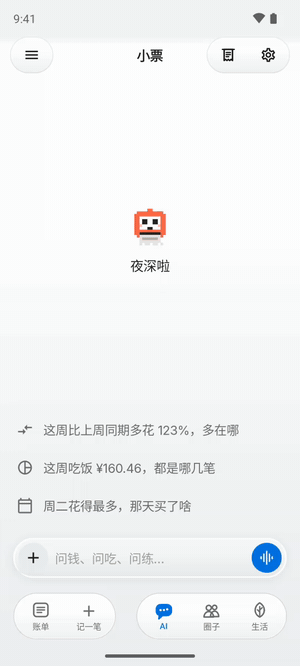</td>
    <td align="center" width="33%">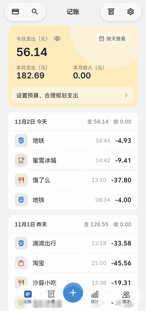</td>
    <td align="center" width="33%">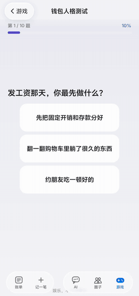</td>
  </tr>
  <tr>
    <td align="center"><b>Ask your own ledger</b> It reads first, then answers — every number has a source</td>
    <td align="center"><b>Print today</b> One tap, and the ledger prints a stamped receipt</td>
    <td align="center"><b>Light games</b> Ten questions to find your wallet personality</td>
  </tr>
</table>

## An AI that only reads your ledger

<table>
  <tr>
    <td align="center" width="33%">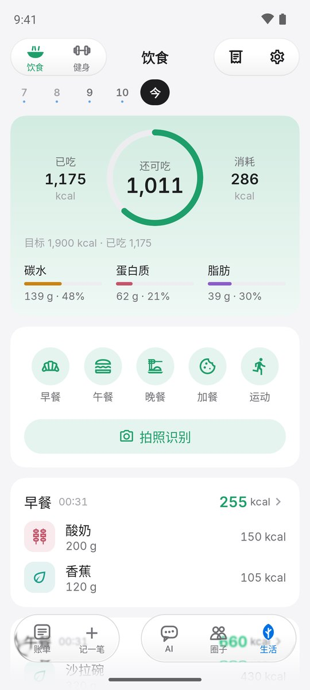</td>
    <td align="center" width="33%">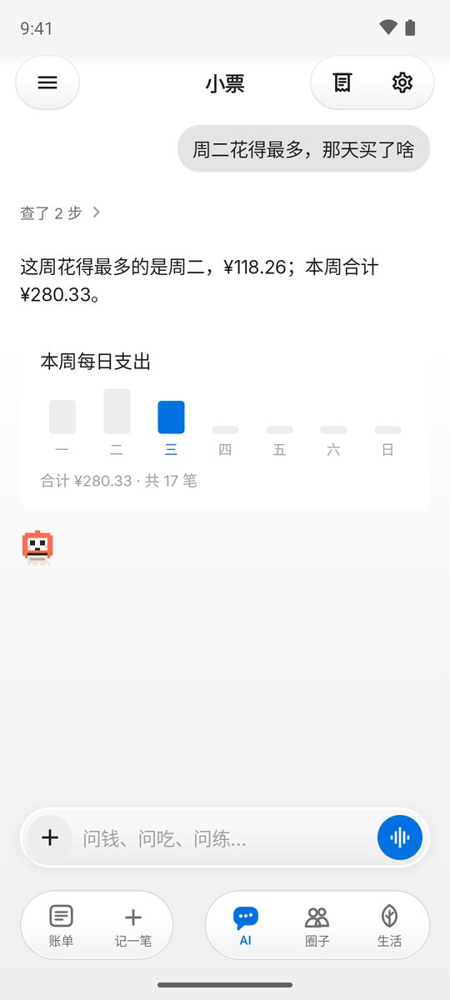</td>
    <td align="center" width="33%">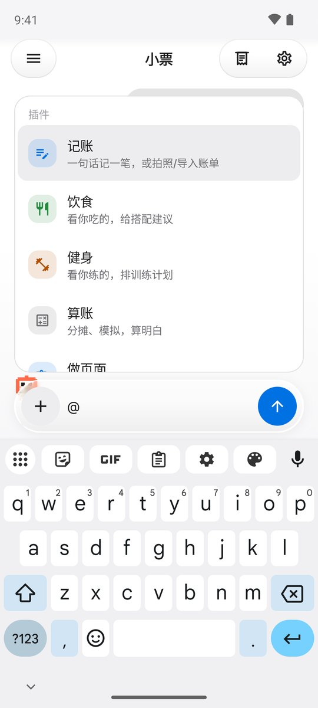</td>
  </tr>
  <tr>
    <td align="center">A clean home; suggestions come from your week</td>
    <td align="center">An expandable thinking trail, answers with charts</td>
    <td align="center">Type <code>@</code> for plugins: log, food, fitness, calculate, build a tracker</td>
  </tr>
</table>

The assistant answers only from your own data: it calls read-only tools first, then turns the result into a sentence and a chart. A number without a source never makes it into an answer. While it works, the input glows softly, and you can stop it at any time.

Screenshots show the Chinese UI; the app is fully bilingual (中文 / English) and follows your language setting.

## The pages you will use every day

<table>
  <tr>
    <td align="center" width="25%">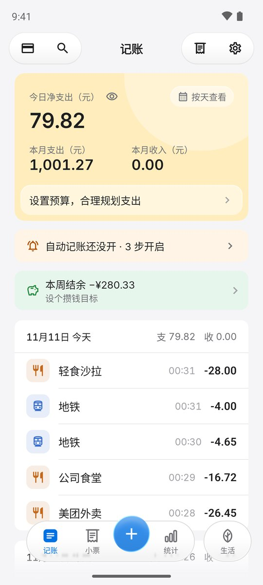</td>
    <td align="center" width="25%">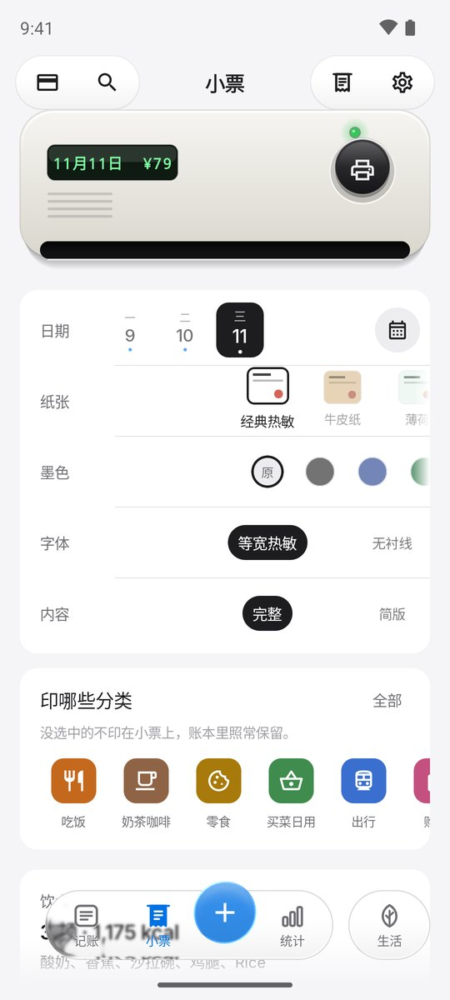</td>
    <td align="center" width="25%">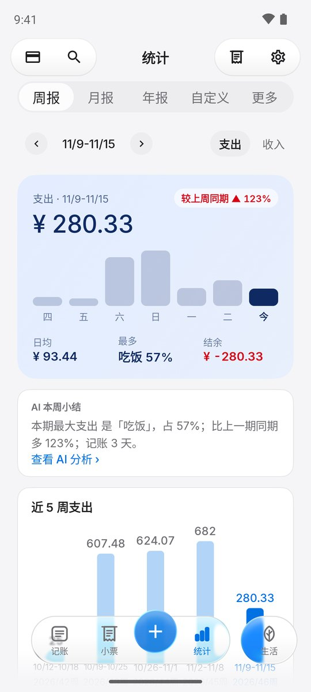</td>
    <td align="center" width="25%"></td>
  </tr>
  <tr>
    <td align="center">Ledger home</td>
    <td align="center">Pick paper, ink and layout</td>
    <td align="center">Weekly report with an AI summary</td>
    <td align="center">Food and fitness, with photo recognition</td>
  </tr>
</table>

Android screenshots with a sample ledger; no real user data.

Lunch, the metro, a coffee, yet another auto-renewal — money goes out, and life happens.

Daily Receipt gathers those scattered records into one ledger, then turns each day into a receipt: the items, the total, and one light-hearted remark. Look at it, tear it off, share it, and get on with your day.

## Every small thing gets an echo

| What you want | How Daily Receipt helps |
|---|---|
| Spend less time logging | With permission on Android, it reads Alipay / WeChat Pay notifications (payments, auto-debits, renewals, income, refunds). Red packets and transfers whose amount isn't shown are logged as "amount to fill in" — one tap to complete. Manual entry, a typed or spoken line, and CSV import also work. |
| Ask your own ledger | Ask in plain language; the AI reads the data through read-only tools and answers with text and charts. Type `@` to pick a plugin directly. |
| Understand today | Each day's spending becomes a receipt, with print, stamp and tear animations to close the day. |
| Eat well, keep moving | Log meals and workouts, recognise a plate from a photo (it can run in the background and tells you when it's done), and see calories and macros. |
| Find your rhythm | Weekly, monthly and yearly stats, your own budget, and where the money went. |
| Catch silent renewals | Spot recurring charges, see the next debit and the running total, and read how to cancel. |
| Share with people you know | Join small circles of family and friends by invite code, QR code or circle ID. Shared receipts keep your paper, ink and layout. Light games and a decision wheel, too. |

> This is a development build under active iteration. Features may differ by version and platform; some scenes use sample data and do not represent real users or shops.

## Architecture

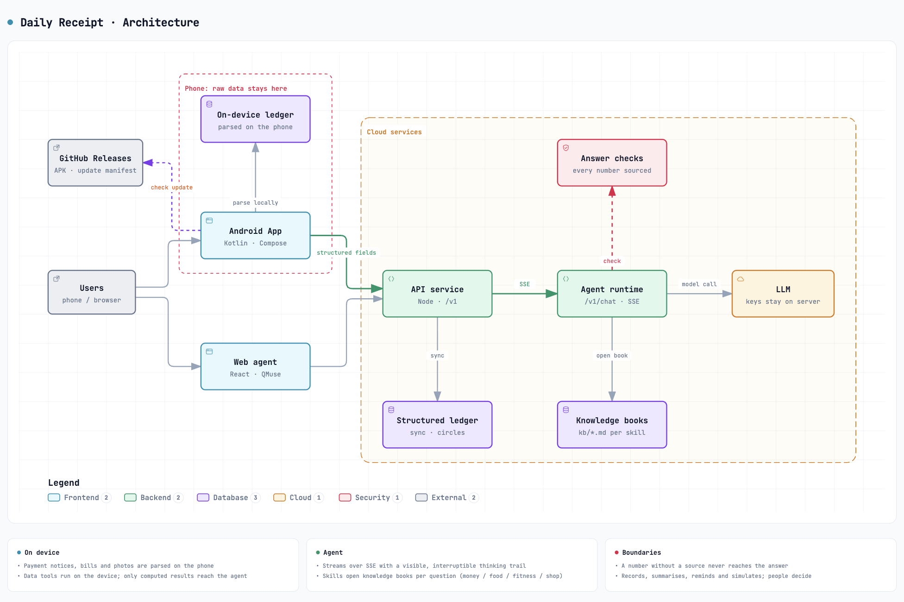

- **Raw data stays on the phone.** Payment notifications, bills and photos are parsed in the app; only structured fields (amount, time, category) sync to the cloud.
- **Numbers are computed on the device.** When an answer needs data, the agent asks the app to run a read-only tool locally and send back the computed result; the model only phrases it.
- **Every answer is checked.** Numbers without a source are blocked, and purchase or investment advice never appears.
- **Knowledge opens on demand.** For money, food, fitness or shop questions, the agent opens only the matching knowledge book (`kb/*.md`) instead of loading every rule.
- **Updates ship through GitHub Releases.** The app reads the update manifest in the latest release, verifies the SHA-256 after download, and hands the APK to the system installer.

## Your ledger, your call

The AI has clear boundaries: it records, summarises, reminds and simulates; the choices stay with people.

- Payment notifications, bills and images are parsed on the phone; cloud sync uses structured fields.
- The on-device speech model is downloaded on demand, and recordings stay on the phone.
- Model credentials live on the server, never in the app or the browser.
- No ordering, no shopping recommendations, no price comparison, no investment-return calls.
- The subscription detective explains how to cancel; you do it yourself.
- Receipts shared to a circle carry category totals only — no merchant names or line items.
- One-tap feedback shows you everything it will send before you press send.

## For the shop on the corner

<table>
  <tr>
    <td align="center" width="50%">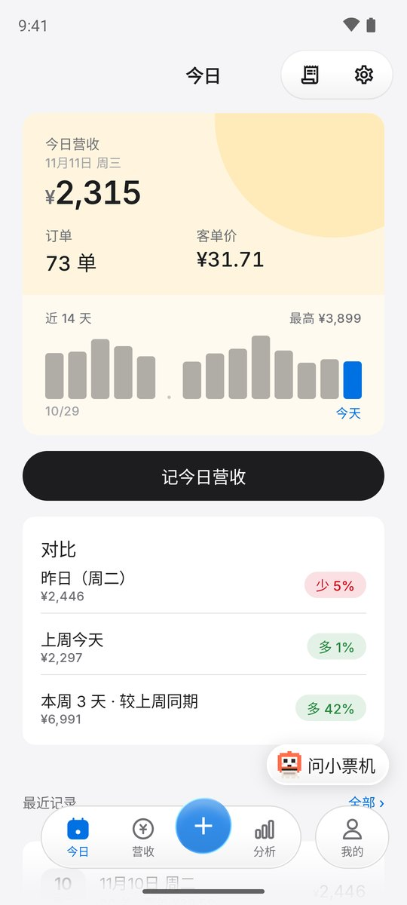</td>
    <td align="center" width="50%">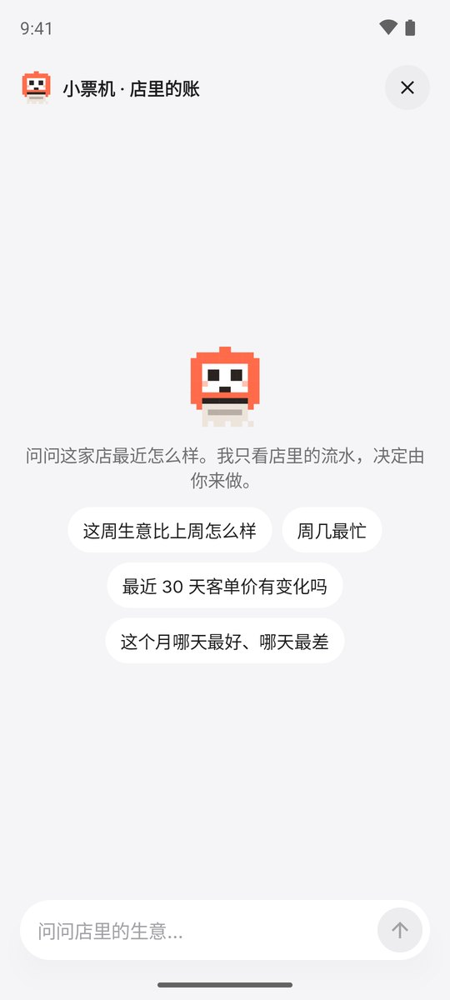</td>
  </tr>
  <tr>
    <td align="center">Today's takings, average ticket, and comparisons</td>
    <td align="center"><i>Ask the bot</i>: business questions answered from the shop's own takings</td>
  </tr>
</table>

The Shop edition keeps a ledger of daily takings and has its own assistant. Revenue, orders, average ticket and weekday patterns are computed on the phone before the assistant sees them, and nothing about customers is involved. It explains and simulates; the owner decides.

**Anonymous aggregates that users choose to contribute** can help small shops understand their neighbourhood. Contribution is off by default, granted separately, and revocable; any cell with fewer than 20 samples is hidden. This part is still evolving, and simulated scenes are not real merchant data.

## Get started

- **Android**: [download `xiaopiao.apk`](https://github.com/37chengshan/xiaopiao/releases/latest/download/xiaopiao.apk) and install it on Android 8.0+. Later versions install from Settings → Check for updates. Automatic logging from notifications needs a separate permission; without it you can still log by hand.
- **Preview**: `xiaopiao-preview.apk` in the release comes with sample data and installs side by side with the regular app.
- **Web**: the competition entry is served through QMuse; [`web/`](web/) in this repo is its build output — preview it with `npx serve web`.

## What's in this repository

This is Daily Receipt's public showcase: product introduction, the web build, app assets and installers. The Android and web source and the server live in a private repository.

| Path | Contents |
|---|---|
| [`web/`](web/) | Web build output (`index.html` + static assets) |
| [`assets/media/`](assets/media/) | Android screenshots, recordings and the architecture diagram |
| [`assets/illustrations/`](assets/illustrations/) | Landing images, empty-state illustrations, spending scenes |
| [`assets/brand/`](assets/brand/) | Logo (SVG), Android launcher and notification icons (vector XML) |
| [Releases](https://github.com/37chengshan/xiaopiao/releases/latest) | Installers (`xiaopiao.apk` / `xiaopiao-preview.apk`) and in-app update manifests |

---

Daily Receipt is an entry to the **Alipay Emergent Agent Award, Season 1**, in the "everyday helper" track.

Feedback, bugs and ideas are welcome in [Issues](https://github.com/37chengshan/xiaopiao/issues). We hope it helps you know your days a little better — and feel a little less chased by bookkeeping.
