

# 今日小票

### 把一天的生活，打印成一张会说话的小票。

少一点手动记账，多一点看懂日常的乐趣。

**Daily Receipt · Android + Web · AI Agent**

[一键下载 APK](https://github.com/37chengshan/xiaopiao/releases/latest/download/xiaopiao.apk) · [更新说明](https://github.com/37chengshan/xiaopiao/releases/latest) · [看看能做什么](#一天的小事都有回声) · [English](#english)

产品氛围图；App 中的小票以屏幕动画呈现，无需购买打印机。

## 先看看它动起来

<table>
  <tr>
    <td align="center" width="33%">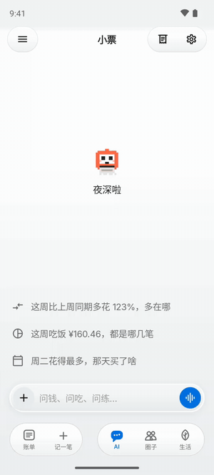</td>
    <td align="center" width="33%">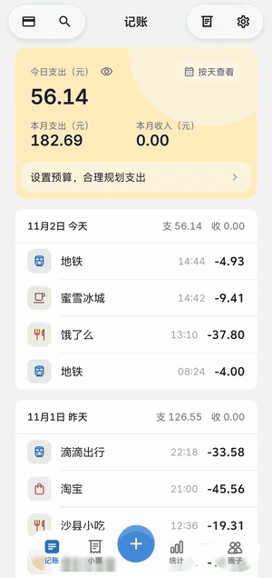</td>
    <td align="center" width="33%">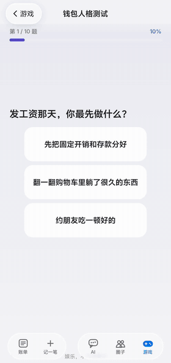</td>
  </tr>
  <tr>
    <td align="center"><b>问问自己的账本</b> AI 先查账，再回答，数字都有出处</td>
    <td align="center"><b>打印今天</b> 点一下，账本吐出一张带印章的小票</td>
    <td align="center"><b>轻量小游戏</b> 十道题，看看你的钱包人格</td>
  </tr>
</table>

## 一个只看你账本的 AI

<table>
  <tr>
    <td align="center" width="33%"></td>
    <td align="center" width="33%">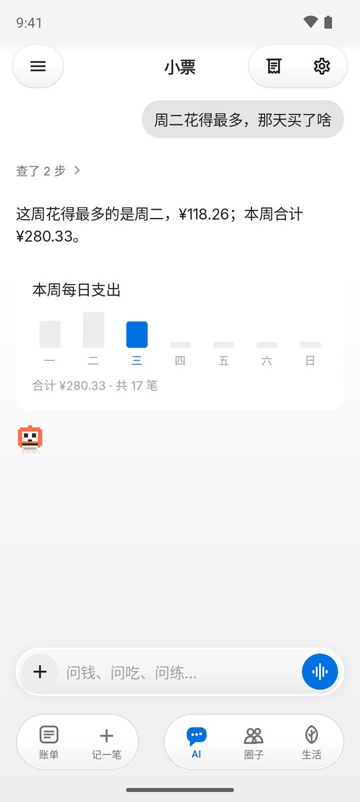</td>
    <td align="center" width="33%">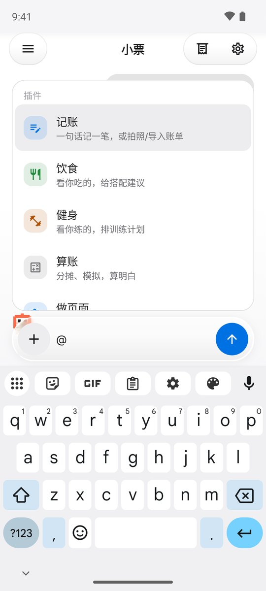</td>
  </tr>
  <tr>
    <td align="center">干净的首页，建议问题来自你这周的账</td>
    <td align="center">思考步骤可展开，答案配图表</td>
    <td align="center">打 <code>@</code> 选插件：记账、饮食、健身、算账、做页面</td>
  </tr>
</table>

小票机只用你账本里的数据回答：它先调用只读工具取数，再组织成一句话和一张图；没有出处的数字不会出现在回答里。回答进行中输入框会亮起一圈流光，随时可以停下。

## 每天会用到的几页

<table>
  <tr>
    <td align="center" width="25%">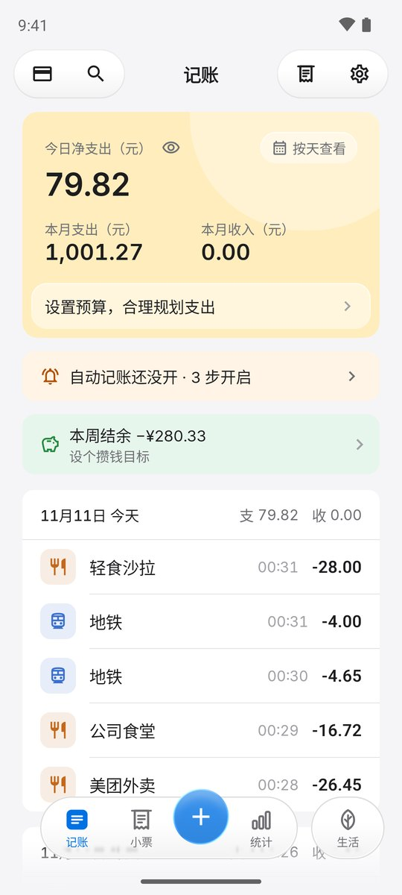</td>
    <td align="center" width="25%">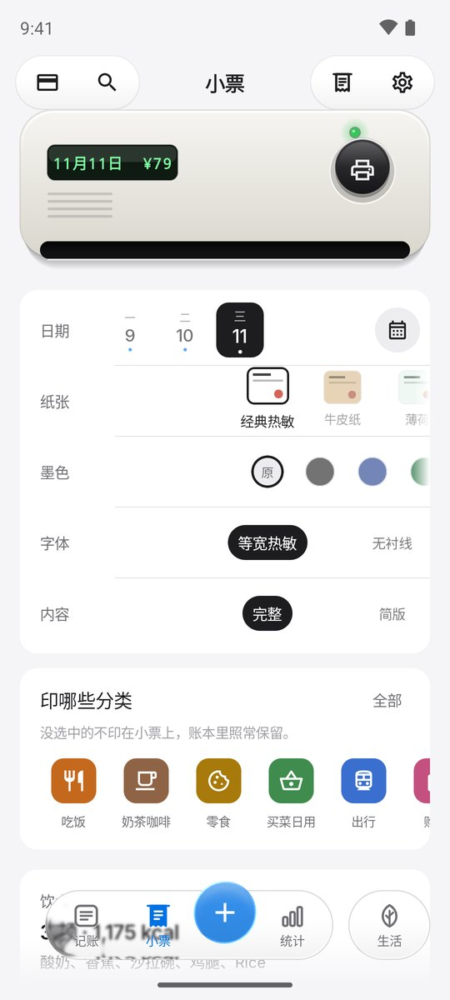</td>
    <td align="center" width="25%">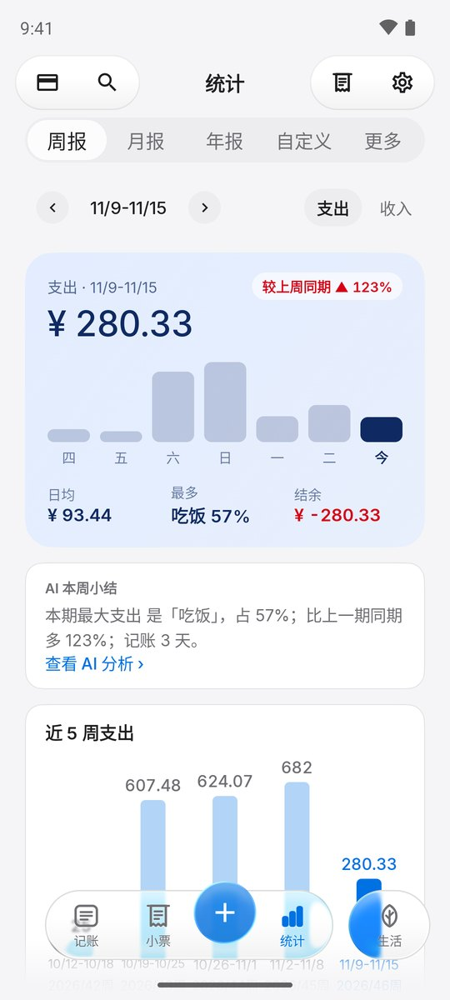</td>
    <td align="center" width="25%">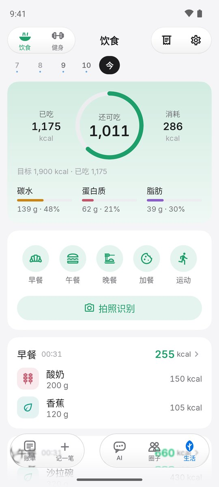</td>
  </tr>
  <tr>
    <td align="center">记账首页</td>
    <td align="center">纸张、墨色、版式自己挑</td>
    <td align="center">周报与 AI 小结</td>
    <td align="center">饮食与健身，可拍照识别</td>
  </tr>
</table>

以上为 Android 截图，使用样例账本，不代表真实用户数据。

午饭、地铁、咖啡、又一次自动续费——钱花出去了，生活也发生了。

今日小票把这些零散的记录整理成一本账，再把一天变成一张小票：有明细、有合计，也有一句轻松的点评。你可以看看、撕下、分享，然后继续过自己的日子。

## 一天的小事，都有回声

| 你想做的事 | 今日小票怎么帮忙 |
|---|---|
| 少花点时间记账 | Android 授权后识别支付宝／微信支付通知（付款、免密／先享后付／自动续费扣费、收款、退款）；看不到金额的红包和转账会先记一笔「待填金额」，点一下补上。也支持手动、一句话、语音和 CSV 导入。 |
| 问问自己的账本 | 用自然语言提问，AI 调用只读工具取数，再用文字和图表回答；打 `@` 可以直接选插件。 |
| 看懂今天花了什么 | 把支出整理成每日小票，用打印、盖章与撕纸动效，给一天一个小小的收尾。 |
| 吃得好、练得动 | 记录三餐和运动，拍照识别餐盘（可放到后台，好了会提醒），看热量和三大营养素。 |
| 找到消费的节奏 | 按周、月、年看统计，自己设定预算，回看钱花在了哪里。 |
| 留意悄悄续费的订阅 | 从重复扣费里识别周期，看看下次扣款和累计花费，查阅取消指引。 |
| 和熟悉的人多一点互动 | 用邀请码、二维码或圈号加入家人朋友的小圈子；分享的小票带着你打印时的纸张、墨色和版式。也有轻量小游戏和决策转盘。 |

> 当前为持续迭代的开发体验版。不同版本与平台的功能覆盖可能不同；部分场景使用样例数据，不代表真实用户或商户案例。

## 你的账本，你来做主

我们给 AI 划了清楚的边界：记录、总结、提醒和模拟，选择始终留给人。

- 支付通知原文、账单原文和图片在本机解析；云端同步使用结构化字段。
- 端侧语音模型按需下载，录音留在手机。
- 模型凭据保存在服务端，不放进 App 或浏览器。
- 不替你下单，不做购物推荐、比价导购或投资收益判断。
- 订阅侦探提供取消指引，由你亲自操作。
- 分享到圈子的小票只带分类合计，不带商户名和逐笔原文。
- 「一键反馈」会先把要发送的内容完整展示给你，点了发送才上传。

## 也关心街角的小店

<table>
  <tr>
    <td align="center" width="50%">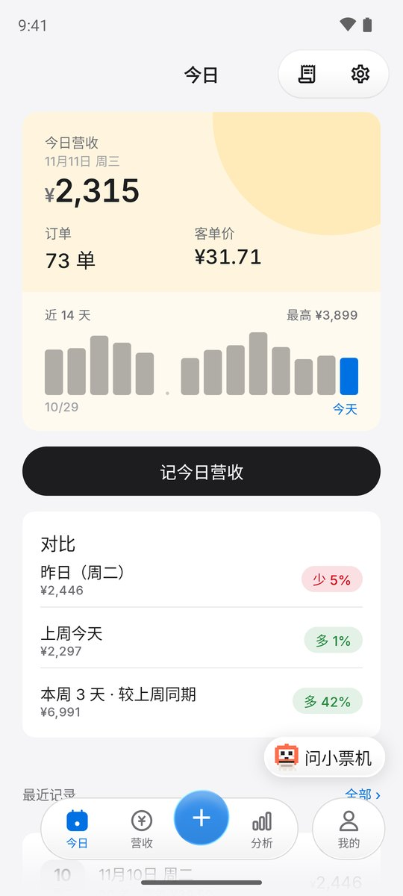</td>
    <td align="center" width="50%">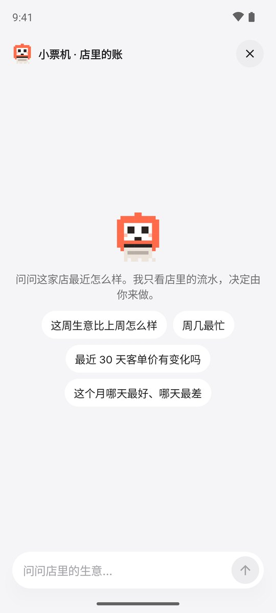</td>
  </tr>
  <tr>
    <td align="center">今日营收、客单价与同期对比</td>
    <td align="center">「问小票机」：用店里的流水回答经营问题</td>
  </tr>
</table>

小店版把每天的营收记成一本账，也有自己的 AI 助手：营业额、单数、客单价、周几规律都在手机上算好再交给它，不涉及任何顾客信息。它解释和模拟，决定由店主来做。

用户**自愿授权的匿名聚合信息**可以成为小店理解社区需求的参考：数据贡献默认关闭、单独授权、可以撤回；样本不足 20 的格子不展示。这部分仍在迭代，界面中的模拟场景不等于已接入真实商户数据。

## 开始体验

- **Android**：[一键下载 `xiaopiao.apk`](https://github.com/37chengshan/xiaopiao/releases/latest/download/xiaopiao.apk)，在 Android 8.0 及以上设备安装。之后在「设置 → 检查更新」里就能直接升级。通知自动记账需要单独授权；不授权也可以手动记账。
- **测试版**：Release 里的 `xiaopiao-preview.apk` 带样例数据，可以和正式版同时安装。
- **Web**：通过 QMuse 提供比赛体验入口；本仓库的 [`web/`](web/) 是它的构建产物，`npx serve web` 即可本地预览。

## 仓库内容

这是今日小票的公开展示仓库：产品介绍、Web 构建产物、App 资源和安装包。Android、Web 源码与服务端在私有仓库维护。

| 位置 | 内容 |
|---|---|
| [`web/`](web/) | Web 版构建产物（`index.html` + 静态资源） |
| [`assets/media/`](assets/media/) | Android 截图与录屏 |
| [`assets/illustrations/`](assets/illustrations/) | 落地页配图、空状态插画、消费场景图 |
| [`assets/brand/`](assets/brand/) | Logo（SVG）与 Android 启动图标、通知图标（矢量 XML） |
| [Releases](https://github.com/37chengshan/xiaopiao/releases/latest) | 安装包（`xiaopiao.apk` / `xiaopiao-preview.apk`）与 App 内更新清单 |

---

## English

**Daily Receipt** turns your day into a talking receipt. It collects payments into one ledger (Android payment notifications, a typed or spoken line, CSV import), prints each day as an animated receipt with a short remark, and lets you **ask your own ledger** in plain language: the assistant reads your data through read-only tools and answers with numbers that have a source, plus a chart. Type `@` to pick a plugin (log, food, fitness, calculate, build a tracker). There is also food and fitness logging with photo recognition, weekly/monthly reports, small circles for friends and family, and a **Shop edition** with its own assistant for a small store's daily takings.

The AI records, summarises, reminds and simulates — every choice stays with you. No purchase advice, no price comparison, no ordering. Raw notifications and images are parsed on the phone; model keys live on the server only.

[Download the APK](https://github.com/37chengshan/xiaopiao/releases/latest/download/xiaopiao.apk) (Android 8.0+) · the app is fully bilingual (中文 / English).

---

今日小票是 **Alipay 智能体涌现奖（Emergent Agent Award）Season 1** 参赛作品，方向为「生活好帮手」。

欢迎通过 [Issues](https://github.com/37chengshan/xiaopiao/issues) 留下使用反馈、问题和想法。希望它让你更了解自己的生活，也少一点被记账追着跑的感觉。
