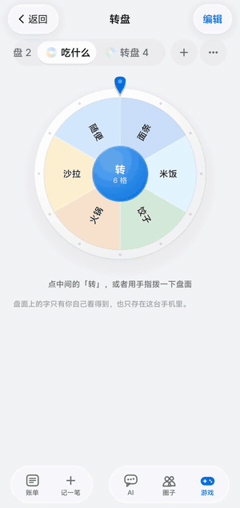
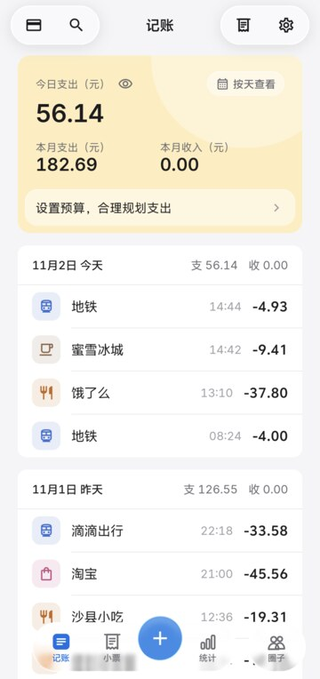
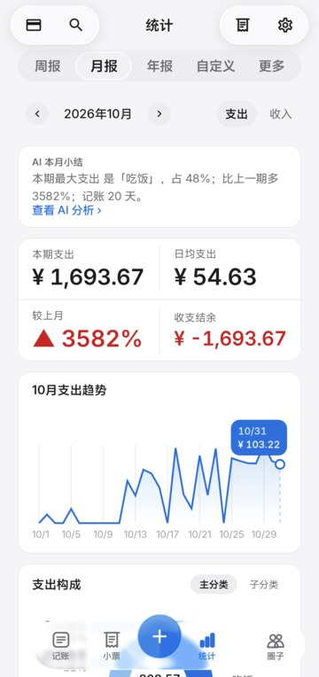
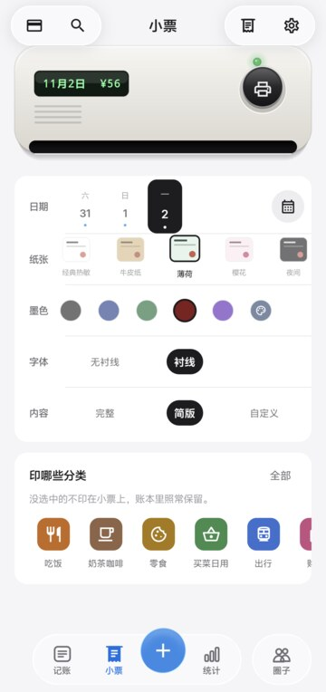
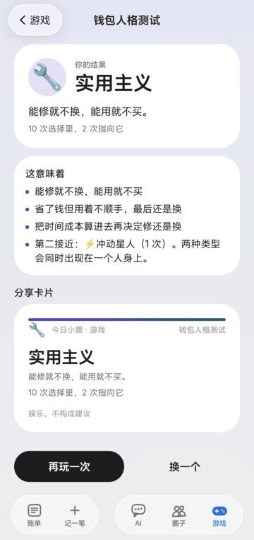
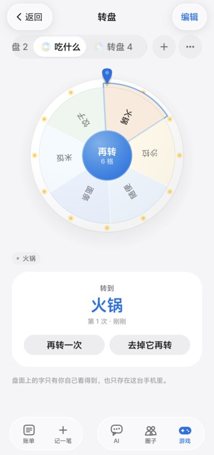

# 今日小票

### 把一天的生活，打印成一张会说话的小票。

少一点手动记账，多一点看懂日常的乐趣。

**Daily Receipt · Android + Web · AI Agent**

[下载 Android APK](https://github.com/37chengshan/xiaopiao/releases/latest) · [看看能做什么](#一天的小事都有回声) · [仓库内容](#仓库内容)

产品氛围图；App 中的小票以屏幕动画呈现，无需购买打印机。

## 先看看它动起来

<table>
  <tr>
    <td align="center" width="33%"></td>
    <td align="center" width="33%"></td>
    <td align="center" width="33%"></td>
  </tr>
  <tr>
    <td align="center"><b>打印今天</b> 点一下，账本吐出一张带印章的小票</td>
    <td align="center"><b>轻量小游戏</b> 十道题，看看你的钱包人格</td>
    <td align="center"><b>决策转盘</b> 选项自己写，转到哪个算哪个</td>
  </tr>
</table>

<table>
  <tr>
    <td align="center" width="20%"></td>
    <td align="center" width="20%"></td>
    <td align="center" width="20%"></td>
    <td align="center" width="20%"></td>
    <td align="center" width="20%"></td>
  </tr>
  <tr>
    <td align="center">记账首页</td>
    <td align="center">月报与 AI 小结</td>
    <td align="center">纸张、墨色、版式自己挑</td>
    <td align="center">测试结果</td>
    <td align="center">多个转盘</td>
  </tr>
</table>

以上为 Android 真机录屏，使用样例账本，不代表真实用户数据。

午饭、地铁、咖啡、又一次自动续费——钱花出去了，生活也发生了。

今日小票把这些零散的记录整理成一本账，再把一天变成一张小票：有明细、有合计，也有一句轻松的点评。你可以看看、撕下、分享，然后继续过自己的日子。

## 一天的小事，都有回声

| 你想做的事 | 今日小票怎么帮忙 |
|---|---|
| 少花点时间记账 | Android 授权后识别支付宝／微信支付通知（付款、免密／先享后付／自动续费扣费、收款、退款）；看不到金额的红包和转账会先记一笔「待填金额」，点一下补上。也支持手动、一句话、语音和 CSV 导入。 |
| 看懂今天花了什么 | 把支出整理成每日小票，用打印、盖章与撕纸动效，给一天一个小小的收尾。 |
| 问问自己的账本 | 用自然语言查询和汇总，AI 调用只读工具取数，再把结果呈现出来。 |
| 找到消费的节奏 | 按时间和分类看统计，自己设定预算，回看钱花在了哪里。 |
| 留意悄悄续费的订阅 | 从重复扣费里识别周期，看看下次扣款和累计花费，查阅取消指引。 |
| 做个“如果当时”的算术题 | 在后悔模拟器里调整消费情景，看看金额如何变化。 |
| 和熟悉的人多一点互动 | 用邀请码、二维码或圈号加入家人朋友的小圈子（圈号需圈主同意）；分享的小票带着你打印时的纸张、墨色和版式，大家看到的就是你那张。设置头像（预设或自己的照片），也玩一点轻量小游戏和决策转盘。 |

> 当前为持续迭代的开发体验版。不同版本与平台的功能覆盖可能不同；部分场景使用样例数据，不代表真实用户或商户案例。

## 从记录到一张小票

**记下来 → 理清楚 → 打印出来 → 由你决定是否分享。**

- **记录尽量轻。** 通知识别、语音和导入服务于同一份账本，记录可以修改，重复数据会去重。
- **数字说清楚。** 金额以整数分保存；统计来自记录，AI 负责组织表达与呈现。
- **反馈看得见。** 打印的纸条、撕下的动作、轻触反馈和可关闭的声音，让记账多一点手感。
- **不登录也能记。** 先在手机上使用，按需登录，再使用账号与结构化账本同步能力。

## 你的账本，你来做主

我们给 AI 划了清楚的边界：记录、总结、提醒和模拟，选择始终留给人。

- 支付通知原文、账单原文和图片在本机解析；云端同步使用结构化字段。
- 端侧语音模型按需下载，录音留在手机。
- 模型凭据保存在服务端，不放进 App 或浏览器。
- 不替你下单，不做购物推荐、比价导购或投资收益判断。
- 订阅侦探提供取消指引，由你亲自操作。
- 分享到圈子的小票只带分类合计，不带商户名和逐笔原文；头像只对自己和同圈子的人可见。
- 「一键反馈」会先把要发送的内容完整展示给你，点了发送才上传。

## 也关心街角的小店

今日小票还有一个“小店版”的探索方向：让用户**自愿授权的匿名聚合信息**，成为社区小店理解消费需求的参考。

数据贡献默认关闭、单独授权、可以撤回；只展示聚合结果，样本不足 20 的格子不展示。小游戏的表达与真实交易数据分开。这部分仍在迭代，界面里的模拟场景不等于已经接入真实商户经营数据。

## 开始体验

前往 [Releases](https://github.com/37chengshan/xiaopiao/releases/latest) 下载 APK，在 Android 8.0 及以上设备安装。通知自动记账等能力需要你在手机上单独授权；不授权也可以手动记账。

Web 版本通过 QMuse 提供比赛体验入口。本仓库的 [`web/`](web/) 是它的构建产物（静态文件），可以直接用任意静态服务器预览。

## 仓库内容

这是今日小票的公开展示仓库：产品介绍、Web 构建产物和 App 资源。Android、Web 源码与服务端在私有仓库维护。

| 位置 | 内容 |
|---|---|
| [`web/`](web/) | Web 版构建产物（`index.html` + 静态资源），`npx serve web` 即可本地预览 |
| [`assets/media/`](assets/media/) | Android 真机截图与录屏 |
| [`assets/illustrations/`](assets/illustrations/) | 落地页配图、空状态插画、消费场景图 |
| [`assets/brand/`](assets/brand/) | Logo（SVG）与 Android 启动图标、通知图标（矢量 XML） |
| [Releases](https://github.com/37chengshan/xiaopiao/releases/latest) | Android 安装包（APK） |

---

今日小票是 **Alipay 智能体涌现奖（Emergent Agent Award）Season 1** 参赛作品，方向为「生活好帮手」。

欢迎通过 [Issues](https://github.com/37chengshan/xiaopiao/issues) 留下使用反馈、问题和想法。希望它让你更了解自己的生活，也少一点被记账追着跑的感觉。
