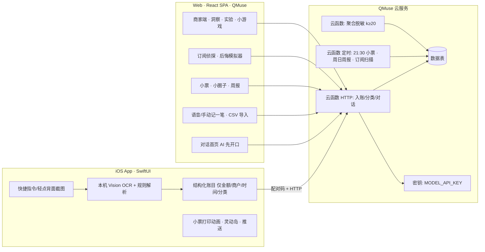

# 今日小票 · Final Spec（智能体涌现奖 S1）

> 定稿：2026-10-27 · 截止：2026-12-06（按 12-05 提交）· 剩余约 39 天
> 来源：两轮 grilling 决策 + 许愿池 812 条去重数据 + 赛事细则 + GitHub 调研
> 2026-10-27 更新：平台改为只做 Android，见 D2/D3；§3 架构中 iOS/Web 部分暂缓。
> 标记 `[假设]` 的项为用户未明确回答、按推荐默认，随时可推翻

---

## 0. 一句话

**每天打印一张会说话的 AI 小票：无感记账、小圈子周报、头衔成就；用户自愿贡献的匿名聚合数据，变成楼下小店老板的经营参考。**

- 参赛方向：主报「生活好帮手」（1.5 家庭记账 / 1.6 订阅审计），B 端呼应「消费新体验」2.1/2.2
- 形态：**Android 原生 App（2026-10-27 用户改为只做 Android）**：读支付宝/微信通知自动记账；Web 端暂缓
- 产品原则：**所有选择由人来做**。AI 只记录、总结、提醒、模拟后果；不推荐买什么、不比价、不下单、不给理财结论

## 1. 需求证据（许愿池）

| 证据 | 数据 |
|---|---|
| 最大需求类目 | 消费记账与财务 149 条 / 812 |
| 支持数 Top1 | 「帮我揪出悄悄扣钱的自动续费」298 → 订阅侦探 |
| 支持数 Top2 | 「人生 RPG：消费/步数自动转经验值」240 → 头衔成就 |
| 商家经营 | 22 条、支持低 → B 端是第二主角，不抢 C 端首屏 |

## 2. 已定决策

| # | 决策 | 结论 |
|---|---|---|
| D1 | 主角 | C/B 双主角，评委两条流程都能点通；C 端为首屏 |
| D2 | 形态 | **只做 Android**（Kotlin + Compose，Apple 风格视觉）；Web/iOS 暂缓 |
| D3 | 入账 | NotificationListenerService 读支付宝/微信支付通知 → 本机规则解析；一句话 / 手动 / CSV 导入兜底 |
| D4 | 记账机制 | 不天天记，只对账：App 截图入账 / Web 语音 + 手动 + 账单 CSV 导入（兜底 & 评委演示） |
| D5 | 主动陪伴 | Web 打开即 AI 先开口（补漏记、昨日回顾）；App 负责推送 |
| D6 | 每日小票 | 21:30 推送 + 下拉随时打印；明细→合计→AI 点评→头衔盖章→撕下分享；零消费日也出票 |
| D7 | 家庭单位 `[假设]` | 「小圈子」通用模型，主打情侣演示；一人（管家）导入，其他人只收周报和头衔 |
| D8 | B 端用户 | 社区小店（奶茶/便利/餐馆） |
| D9 | 数据底线 | 原文不出手机；默认关闭、单独授权贡献；只给聚合，样本 ≥20 人才展示；演示数据显式标注 |
| D10 | 知识库 | v1：订阅侦探 + 后悔模拟器；「坏了先别扔」「办事预检官」为「即将上线」入口 |
| D11 | 人手 `[假设]` | 1–2 人 → 按 P0/P1/P2 分级，不删需求只排序 |

## 3. 系统架构

- QMuse 云函数支持 **HTTP 触发 + 定时触发**（已查文档）→ 每日小票/周报/订阅扫描用定时函数
- App 与 Web 共用账号：Web 生成「配对码」，App 用它换取同步令牌调用 HTTP 云函数
- 模型：国内可用大模型（如通义千问/DeepSeek，经云函数调用，密钥只在云端）；封装成单一 `llm()` 接口便于替换

### 数据表

| 表 | 关键字段 |
|---|---|
| users | id, nickname, circle_id, contribute_opt_in, created_at |
| circles | id, name, type(couple/family/roommates), owner_id |
| transactions | id, user_id, amount, merchant, category, occurred_at, source(shortcut/voice/manual/csv), dedupe_key |
| receipts | id, user_id, date, items_snapshot, ai_comment, title_badge |
| badges | id, user_id, badge_code, period, reason |
| subscriptions | id, user_id, merchant, amount, cycle, next_charge_at, status |
| merchant_experiments | id, merchant_id, game_type, options, status |
| game_responses | id, experiment_id, user_id_hash, choice, created_at |
| audit_log | id, actor, action, target, created_at |

## 4. C 端功能

### 4.1 入账（三条路，全部可撤销/编辑）
- **App 截图入账**：支付成功页截图 → 本机 OCR → 解析 → 弹出确认卡（默认 3 秒自动确认，可点改）
- **Web 一句话**：「午饭 32」「昨天打车 18 和奶茶 15」→ AI 拆成多笔，卡片确认
- **CSV 导入**：支付宝/微信账单 → 解析规则移植自 `deb-sig/double-entry-generator` → 去重合并

### 4.2 每日小票（核心仪式感）
动画分镜：推送「今日小票已出炉」→ 打开后打印机口滑出纸条（逐行 + 轻触感 + 打印声可关）→ 合计金额数字滚动 → AI 一句点评（俏皮，不说教）→ 头衔印章「咔」盖下（弹簧 + 微缩放 + 墨迹扩散）→ 上滑「撕下」→ 分享到小圈子 / 存相册
- 弹窗细节：确认卡、撤销 Toast、空状态、网络失败重试、首次授权说明各一套文案与动效
- Web 用 CSS/Framer Motion 复刻同一分镜（评委看得到）

### 4.3 小圈子 + 周报 + 头衔
- 周日 20:00「周报颁奖典礼」：每人一张卡，本周 Top 类目、对比上周、AI 总结、颁 1–2 个头衔
- 头衔：规则触发 + AI 写文案。示例：奶茶战神 / 外卖绝缘体 / 钱包休眠者（零消费日）/ 早餐守护者 / 订阅清道夫
- 管家导入，成员零操作；成员只看自己+圈子汇总，明细默认不互看

### 4.4 订阅侦探（许愿池 Top1）
- 从账目中识别「同商户 + 相近金额 + 周期性」→ 订阅清单、年化总额、下次扣费日
- 扣费前 3 天提醒；给出「如何取消」步骤指引；**不代操作**

### 4.5 后悔模拟器
- 「如果过去 3 个月少喝一半奶茶……」→ 用真实账目算省下多少、换算成具体可感物（一次周末旅行/N 顿火锅）
- 只做算术模拟，不涉及收益率与投资建议，页面带免责说明

### 4.6 Web 主动陪伴
- 打开即 AI 开场：昨日小票回顾 / 「可能漏记了早餐？」/ 本周进度
- 超过 1 天未入账：开场优先引导补记

## 5. B 端功能（商家端，顶栏一键切换）

1. **人群洞察看板**：附近授权用户的聚合消费画像（品类占比、时段、价格带）；样本 <20 的格子置灰；角标「演示数据」
2. **发起实验**：选模板 → 生成小游戏 → 推送给授权的 C 端用户
3. **看结果**：选择分布 + 样本量 + 置信提示（「样本 63 人，结论较稳定」）
4. **AI 给 3 个可选动作**，老板自己选，系统记录选择与后续复盘

### 小游戏（数据标注为「游戏表态」，与真实交易严格区分）

| 游戏 | 测什么 | 优先级 |
|---|---|---|
| 二选一大作战（「第二杯半价」vs「送小料」） | 促销偏好 | P0 |
| 猜价格（你觉得这杯值多少） | 价格敏感区间 | P2 |
| 开店一周（自己当老板选菜单） | 品类偏好 | P2 |

C 端参与游戏可得头衔/徽章，不发现金激励（避免「诱导」嫌疑）

## 6. 合规与可信（写进说明材料）

- 截图/原文只在本机解析，云端只存结构化字段
- 数据贡献：默认关闭、单独授权、随时撤回、一键删除我的全部数据
- B 端只见聚合，k≥20；游戏数据与交易数据分开存、分开标注
- 演示期所有商家侧数据标注「演示数据」，不冒充真实案例
- 不给金融确定性结论；模型密钥只在云函数
- 隐私说明页 + 首次授权说明弹窗

## 7. 优先级

| 级 | 内容 |
|---|---|
| **P0**（评审必需） | Web：对话首页、语音/手动/CSV 入账、每日小票动画、小圈子周报+头衔、订阅侦探、后悔模拟器、商家端 4 步 + 二选一游戏、隐私页；云函数 + 定时任务 |
| **P1**（自用 + 视频高光） | iOS App：快捷指令截图入账、小票打印动画、推送、灵动岛「今日已花」 |
| **P2**（有余力） | 猜价格/开店一周、Android 读通知（参考 AutoAccounting）、「即将上线」两个知识库 |

## 8. 节奏（10-28 → 12-05）

| 周 | 日期 | 产出 |
|---|---|---|
| W0 | 10-28 → 10-30 | 模板跑通出 URL；**Spike：App 能否经 HTTP 调云函数、定时触发可用**；数据表建好 |
| W1 | 10-31 → 11-06 | 入账三条路（Web 侧）+ 分类云函数 |
| W2 | 11-07 → 11-13 | 每日小票（Web 动画）+ 小圈子 + 周报头衔 |
| W3 | 11-14 → 11-20 | 订阅侦探 + 后悔模拟器 + AI 先开口 |
| W4 | 11-21 → 11-27 | 商家端 4 步 + 二选一游戏 + 聚合脱敏；iOS App 并行 |
| W5 | 11-28 → 12-02 | 打磨：空/错/慢状态、移动端、弹窗文案；iOS 小票动画 |
| W6 | 12-03 → 12-05 | 封面 16:9、90 秒视频（截图入账→打印小票→周报颁奖→商家实验）、说明材料、提交 |

## 9. 复用清单（不重复造轮子）

| 用途 | 项目 |
|---|---|
| 支付宝/微信 CSV 解析规则 | deb-sig/double-entry-generator（732⭐） |
| 通知读取自动记账（Android, P2） | AutoAccountingOrg/AutoAccounting（961⭐） |
| 多人分摊/最少转账 | TechFunWay/bill |
| Web 底座 | QMuse 官方模板（React + Vite + TanStack Router + shadcn） |

## 10. 风险与待验证

1. App ↔ QMuse 云函数直连（W0 Spike）；不通则改为 App 本地优先 + Web 配对导入
2. iOS 自用安装：无付费开发者账号时 7 天重签；上 TestFlight 需 $99/年
3. 截图 OCR 准确率：先覆盖支付宝/微信支付成功页两种版式
4. 定时推送：Web 无法离线推送，靠 App；评委侧以「打开即 AI 开场」体现
5. 截止口径：按 12-05 完成提交
