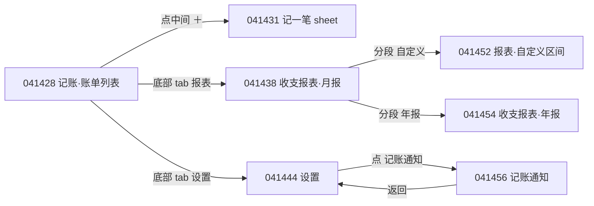

# 参考钱包 UI 拆解 · A 组（7 张，2026-10-28 04:14 连拍）

竞品：一木记账式钱包 App（Android / vivo 系截图）。本文件只描述**模式**，不抄品牌、logo、文案。
用途：校准「今日小票」`docs/APP-DESIGN.md` §3.2（账单页）/ §3.3（统计页）/ §2（我的与设置）。

## 0. 量测基准与可信度

- 原图 1260 × 2800 px。按状态栏 28dp、页标题 18–20sp 交叉标定，得 **3.5 px/dp**（等效 360 × 800 dp 屏）。本文所有 dp = px ÷ 3.5。
- 颜色为 JPEG 采样中位数（同一色块多点取样），±2 灰阶误差；带「约」的是目测/圆角拟合值，其余为像素量测。
- 圆角用角部曲线拟合（逐行找边缘）；卡圆角误差 ±2dp。
- 7 张全部**已实际打开逐张查看**（041428 / 041431 / 041438 / 041444 / 041452 / 041454 / 041456），另做了局部放大裁剪复核文字与控件。

状态链（同一分钟内连拍，推断的页面跳转关系）：

## 1. `041428` 记账（账单列表）· 默认态

页面：App 主 tab「记账」= 账单列表；顶部有一条在跑的公告条；中段是「今日/本月」奶油色汇总卡；下面 3 张日期分组卡；底部 5 格导航（中间凸起 ＋）。

| 区块 | 内容 | 高度 dp | 尺寸/圆角/间距 | 颜色 | 字号/字重 |
|---|---|---|---|---|---|
| 状态栏 | 系统 | 28 | 白底，图标深色 | `#FFFFFF` | — |
| 顶栏 | 左 `‹` + 标题「记账」；右 3 个线性图标：账单列表 / 搜索 / 方框对勾（多选） | 48 | 左内边距 20；图标 24dp，中心距 46dp，右侧留 20 | 字 `#1A1A1A`，图标同色 | 标题 18sp / 600 |
| 公告条 | 「微信自动记账内测结束…」单行横向循环滚动 | 32 | 圆角 8，左右 20，喇叭图标 16dp | 底 `#FFF3D3`，字/图标 `#FF712D` | 13sp / 400 |
| 汇总卡 | ①「今日支出(元)」+ 眼睛图标；② `18.28`；③ 两列「本月支出(元) 631.92 / 本月收入(元) 120.00」；④ 底条「设置预算，合理规划支出 ›」 | 178（主体 137 + 底条 41） | 圆角 14，内边距 20，左右 20；两列分割在 50%，列间距 24；底条上沿无分隔线，仅换底色 | 卡 `#FFEDBD`（带更浅的装饰圆 `#FFF3D3`），底条 `#FFFBF0`；标签 `#8E8E93`；数字 `#1A1A1A` | 标签 13sp/400；主数字 30sp/600 tnum；次列 22sp/600 tnum；底条 15sp/400 |
| 卡间距 | — | 14 | — | 页面底 `#F2F2F4` | — |
| 分组卡 ×3 | 卡头 + 1–2 行 | 110 / 165 / 103 | 圆角 10，左右 20（卡宽 320），卡间距 14 | 卡 `#FFFFFF` | — |
| 卡头 | 左「10月28日 今日」；右「支 18.28　收 0.00」 | 44 | 左右内边距 16 | 左 `#1A1A1A`，右 `#8E8E93` | 13sp / 500 · 13sp/400 |
| 卡内分隔线 | — | — | 0.5dp，左缩进 16 | `#EFEFEF` | — |
| 列表行 | 彩色 emoji 分类图标（无底色块）+ 分类名 + 第二行：来源胶囊 + 时间 + 竖线 + 商户 + 右侧金额 | 60 | 图标 24dp（emoji 原彩）；行内左右 16；名称与第二行间距 4 | 名称 `#1A1A1A`；第二行 `#B2B2B2`；胶囊描边 `#DCDCDC` | 名称 16sp/500；第二行 13sp/400；胶囊 11sp/400；金额 17sp/600 tnum |
| 底部导航 | 记账 / 报表 /（＋）/ 发现 / 设置 | 66 | 5 等分；图标 24dp，标签 10sp，图标与文字间距 2；中央 ＋ 为 44dp 实心圆，上凸 10dp 压住导航上缘 | 导航底 `#F6F6F6`（与页面 `#F2F2F4` 几乎同色，**无分隔线**）；选中 `#435FFF`，未选 `#9A9A9E` | 标签 10sp / 400（选中 500） |
| 悬浮 AI 球 | 右下角，AI 头 + 「AI」字 | 56 | 距导航上缘 12，距右 16 | 紫色渐变徽 + 白字 | 11sp / 600 |

- **视觉重点**：奶油色汇总卡（全屏唯一大面积彩色）里的 30sp `18.28`；其次是 ＋ 的蓝色圆。
- **对齐**：单一左栅格 20dp；金额与图标右缘统一在距右 20dp；卡内文字再缩进 16dp；两列数字左对齐（不右对齐），列分割在屏宽中点。
- **层级手段**：底色差（`#F2F2F4` 页 / `#FFFFFF` 卡）+ 奶油卡 + 字重，零阴影、零描边（除来源胶囊 1px）。

## 2. `041431` 记一笔（底部 sheet）

页面状态：从账单页点中央 ＋ 后弹出的全宽 sheet，背景压 34% 黑遮罩；键盘内嵌（自绘数字键盘，不是系统输入法）；金额为空，保存按钮处于禁用态。

| 区块 | 内容 | 高度 dp | 尺寸/圆角/间距 | 颜色 | 字号/字重 |
|---|---|---|---|---|---|
| 遮罩 | — | — | 覆盖全屏 | `#000000` 34% | — |
| Sheet 容器 | 全宽白面板，高 578（从 222dp 起） | 578 | 顶角 28dp，底角 0 | `#FFFFFF` | — |
| 关闭 | 右上 `×` | 44 触达 | 24dp 图标，距右 20，距顶 16 | `#1A1A1A` | — |
| 分段胶囊 | 支出（选中）/ 收入；右侧「今天 ▾」「19:14 ▾」 | 30 | 胶囊圆角 15，横向内边距 16，组间距 8；右侧两枚同高灰胶囊，距右 20 | 选中底 `#E6ECFF` 字 `#4160FF`；未选底 `#F2F2F4` 字 `#1A1A1A` | 15sp / 600 |
| 金额行 | `¥` + 输入位 + 1.5dp 蓝色光标 | 64 | 下划线 1px 通宽（减去 20 内边距） | 符号/数字 `#1A1A1A`；光标与线 `#4160FF` / `#E6E6E8` | ¥ 22sp/500；数字 30sp/600 tnum |
| 分类网格 | 5 列，可滚动（右侧 2dp 滚动条）；格 = 图标 + 标签；部分格右上 10dp `▾`（有子类） | 格高 65 | 图标 24dp 线性；选中态在图标下垫 32dp 圆角 8 实心块 | 未选图标 `#B8B8BC`、标签 `#666666`；选中块 `#4160FF` + 白图标、标签 `#1A1A1A` | 标签 13sp / 400（选中 500） |
| 备注 | 胶囊输入 + 右侧圆形相机键 | 36 | 胶囊圆角 18，内边距左右 16；相机键 36dp 圆 | 胶囊 `#F2F2F4`，占位 `#A0A0A0`；相机键 `#F2F2F4` + `#666666` 图标 | 15sp / 400 |
| 数字键盘 | 4 列 × 4 行：7 8 9 ⌫ / 4 5 6 − / 1 2 3 ＋ / 再记一笔 0 . 保存 | 200 | 行高 49，列等分；保存按钮 86 × 48，圆角 12 | 键字 `#1A1A1A`；「再记一笔」`#B0B0B0`；保存禁用 `#C0CAFB` + 白字 | 数字 22sp/500；符号 20sp；再记一笔 15sp；保存 17sp/600 |

- **视觉重点**：金额行的光标与「¥」；其次是蓝色实心分类格；保存按钮刻意低饱和（5% 信息量），不抢焦点。
- **对齐**：内容左右 20dp；分类 5 等分且图标+文字居中对齐；键盘 4 等分、数字居中；保存键贴右 20dp，与「再记一笔」同基线。
- **交互推断**：
  - sheet 上滑进入（推断 220–260ms 弹簧），下滑或 `×` 关闭，关闭不改任何数据。
  - 支出/收入切换 = 唯一的分段，切换后分类集可能变化（收入分类集不同）。
  - 「今天 ▾」「19:14 ▾」分别开日期选择器 / 时间选择器（原生 wheel 或底部小 sheet，未在此组出现）。
  - 分类格点击 = 选中；带 `▾` 的格（餐饮、购物、住房、交通、通讯、娱乐）再展开子类（二级网格，未出现在本组）。
  - 相机键 = 拍照 / 相册记账（OCR 小票），入口只一个图标。
  - 金额为 0 时保存禁用（`#C0CAFB`）；填了金额后转 `#4160FF`。「再记一笔」在 0 笔时禁用（灰）。
  - 与上一张的关系：账单列表 → ＋ → 本 sheet；保存后关 sheet 回列表并插入新行（推断有 300ms 高亮）。

## 3. `041438` 收支报表 · 月报

页面：底部 tab「报表」的一级页；头部是白底（含状态栏），正文是灰底 + 白卡。

| 区块 | 内容 | 高度 dp | 尺寸/圆角/间距 | 颜色 | 字号/字重 |
|---|---|---|---|---|---|
| 头部白底区 | 状态栏 + 顶栏 + 分段 + 期间行，整块白 | 190 | 无下边框，直接接灰底 | `#FFFFFF` | — |
| 顶栏 | `‹` + 「收支报表」+ 右「订阅设置」（文字按钮） | 56 | 左 20 / 右 20；返回图标 24dp | 标题 `#1A1A1A`；右文字 `#4160FF` | 20sp/600 · 15sp/500 |
| 分段 | 周报 · 月报 · 年报 · 自定义，四等分 | 48 | 文字居中；选中下划线 3dp，宽 ≈ 文字宽 + 8，距文字底 10 | 选中 `#1A1A1A` + `#4160FF` 线；未选 `#B5B5B8` | 17sp / 500 |
| 期间行 | `‹` 圆钮 + 「2026年10月」+ `›` 圆钮；右侧支出/收入胶囊 | 48 | 圆钮 28dp（底 `#F2F2F4`）；胶囊 28dp 高、圆角 14、内边距 12/组间距 4 | 圆钮 `#F2F2F4`，箭头 `#1A1A1A`；选中胶囊 `#E3EAFF`/`#4160FF`，未选 `#F2F2F4`/`#1A1A1A` | 期间 17sp/600；胶囊 13sp/500 |
| 卡 A 上段 | 渐变面板：AI 头像 +「AI 月度小结」+ 2 行正文 + 链接 | 70（不含压边的头像） | 卡圆角 18，左右 20；头像 36dp，左 20，上移 10dp 压边；正文行高 1.5，最多 2 行 | 渐变 `#E9EFFF` → `#EDE7FF`（右上偏紫）；正文 `#303030`；链接 `#4160FF` | 标题 17sp/600；正文 15sp/400；链接 15sp/500 |
| 卡 A 下段 | 2 × 2 KPI：10月支出 631.92 / 日均支出 22.57 / 比上月支出 40.27 / 收支结余 -511.92 | 100（合计卡 204） | 白面板圆角 16、左右内缩 6；行距 54，列分割 50%；无分隔线、无色块 | 标签 `#8E8E93`，值 `#1A1A1A`（负值也是墨色） | 标签 13sp/400；值 24sp/600 tnum |
| 卡 B 图表 | 标题「10月支出趋势」+ 折线面积图 | 242 | 卡圆角 18，内边距 20；图区高 88；Y 轴 6 刻度、X 轴 8 刻度 | 标题 `#1A1A1A`；轴字 `#999999`；网格竖线 1px `#F0F0F0`；线 `#4160FF` 2dp；面积渐变 `#4160FF` 18%→0 | 标题 17sp/600；轴 11sp/400 |
| 图表 tooltip | 常驻在当前期：蓝气泡两行「10/28 支出」「¥18.28」+ 1px 虚线引到图底 | — | 气泡圆角 10，内边距 8×10，下三角 6dp；虚线 dash 4/4 | 气泡 `#4160FF`，字白，虚线 `#4160FF` 40% | 13sp / 500 |
| 图表数据点 | 当前期 8dp 白心 + 2dp 蓝环 | — | — | `#FFFFFF` / `#4160FF` | — |
| 卡 C（露头） | 「支出分类构成」+ 右侧 主分类 / 子分类 胶囊 | — | chip 24dp 高、圆角 12、内边距 5 | 选中 `#ECEFFF`/`#4160FF`，未选 `#F2F2F4`/`#333333` | 13sp / 500 |

- **视觉重点**：渐变 AI 卡（唯一渐变）+ 折线峰值上的蓝色 tooltip；KPI 数字是第二层。
- **对齐**：卡内一律左 20dp；KPI 标签与值左对齐（不居中）；Y 轴标签右对齐到图区左缘（距图区 8dp）；X 轴刻度与竖网格线同 x，居中于刻线。
- **交互推断**：
  - 分段切周/月/年/自定义：页内不跳转，图表与 KPI 重算；下划线 3dp 随文字滑动（推断 180ms）。
  - `‹` `›` 切上一/下一期间；年报里两侧圆钮都在，月报右侧那颗几乎看不见（同组件、不同透明度来源不明，属于参考的不一致）。
  - 支出/收入胶囊切换后图表与 KPI 全部换维度，KPI 标签同步改写（「本月收入」）。
  - 点图上任意点 → tooltip 移过去（当前期默认常驻）；点 tooltip 推断进入该期账单列表。
  - 右上「订阅设置」= 文字按钮进二级页（报表订阅/推送），是报表页唯一的非图标入口。

## 4. `041444` 设置（二级页）

页面：底部 tab「设置」的一级页；**顶栏没有白底**，标题直接压在灰底上（与 `041438` 的白顶栏不一致）。

| 区块 | 内容 | 高度 dp | 尺寸/圆角/间距 | 颜色 | 字号/字重 |
|---|---|---|---|---|---|
| 顶栏 | `‹` + 「设置」 | 48 | 左 20；返回 24dp | 灰底 `#F2F2F4`，字 `#1A1A1A` | 20sp / 600 |
| 卡 1 | 「自动记账设置」+ 副标「累计记账821天」+ `›` | 77 | 卡圆角 14，左右 20；行内 16；副标与标题间距 4 | 卡 `#FFFFFF`；标题 `#1A1A1A`，副标 `#8E8E93`，箭头 `#C7C7C7` | 标题 17sp/500；副标 13sp/400 |
| 卡 2 | 8 行：记账通知 / 记账分类管理 / 功能管理 / 更换主题卡片 / 导出数据 / 导入数据 / 帮助与反馈 / 添加记账至桌面 | 389 | 行高 48；分隔线 0.5dp 左缩进 16；末行右侧描边胶囊按钮（h 28，圆角 14，内边距 10） | 卡 `#FFFFFF`；字 `#1A1A1A`；线 `#EFEFEF`；按钮描边+字 `#4160FF` | 行 17sp/500；按钮 13sp/500 |
| 卡间距 | — | 14 | — | `#F2F2F4` | — |

- **视觉重点**：几乎没有——这是全组最"素"的一页：只有文字与 0.5dp 线。说明该 App 把彩度全留给账单/报表。
- **对齐**：左 20 / 卡内 16；箭头与开关统一右缘 16；没有图标列（纯文字行）。
- **交互推断**：整行可点（行高 48 = 触达）；「导出数据 / 导入数据」推断走系统文件选择器；「更换主题卡片」推断进二级页；末行按钮是唯一彩色。

## 5. `041452` 收支报表 · 自定义区间

页面：同报表页，分段切到「自定义」，期间换成日期范围；KPI 只剩 2 格；分类构成与名次列表合并在同一张卡（与月报/年报的「环 + 排行」分卡不同）。

| 区块 | 内容 | 高度 dp | 尺寸/圆角/间距 | 颜色 | 字号/字重 |
|---|---|---|---|---|---|
| 期间行 | 「2026/9/29-2026/10/28 ▾」+ 支出/收入胶囊 | 48 | **无 `‹ ›` 圆钮**；文字后跟 16dp `▾`；胶囊同上 | 同 §3 | 17sp/600 |
| 卡 1 KPI | 只 2 格：支出 670.32 / 收支结余 -550.32 | 100 | 单行 2 列，列分割 50% | 同 §3 | 24sp/600 |
| 卡 2 头 | 标题「支出分类构成」+ 主分类/子分类 chip | 64 | chip 24dp 高、圆角 12、内边距 5；与标题同基线右对齐 | 选中 `#ECEFFF`/`#4160FF`；未选 `#F2F2F4`/`#333333` | 标题 17sp/600；chip 13sp/500 |
| 环形图 | 5 段甜甜圈 + 环外引线标签 + 中心金额 | 148（外径） | 外径 148、内径 68（45%）、环宽 40；段间白缝 2dp；从 12 点顺时针；引线 1dp 同色折线 | 调色板 `#567DFF` `#7BA6FF` `#5BC3FF` `#B9EFE4` `#FFCC1F`；中心数字 `#1A1A1A`，单位 `#999999` | 中心 22sp/600 + 12sp/400；外标签 13sp/400（名称 `#666666`，百分比 `#333333`） |
| 名次列表 | 5 行：名次 + 分类图标 + 名称 + 笔数 + 名称下占比条 + 金额 + `›` | 行 60 | 图标 32dp 圆角 10（无底色，图像本身着色）；占比条 3dp 高、轨道 `#EFEFF1`；行内左右 20 | 名次 `#B2B2B2`；名称 `#1A1A1A`；笔数 `#8E8E93`；金额 `#1A1A1A`；箭头 `#C7C7C7` | 名次 13sp/400（**不用 accent**）；名称 16sp/500；笔数 13sp；金额 17sp/600 |

- **视觉重点**：环形图（最大彩色块）→ 中心 338.76；名次列表用「占比条」把注意力从上往下引。
- **对齐**：环心与卡中线对齐（略偏左，为右侧引线留位）；外标签按象限自动左右分布，拥挤处两行堆叠；名次列表名次列固定 16dp 宽左对齐，金额右对齐。
- **交互推断**：
  - 期间行的 `▾` 打开日期范围选择器（替代 `‹ ›`）；这是「自定义」与「周/月/年」唯一的形态差异。
  - 主分类/子分类切换重算环与排行（切换动画推断 200ms 角度过渡）。
  - 环段点击 → 该分类的账单列表（推断）；名次行整行可点 → 同上；`›` 只是提示。
  - 与 `041438` 的关系：同页不同分段，头部（顶栏/分段/胶囊）完全共享，只有期间控件与卡片数量变化。

## 6. `041454` 收支报表 · 年报

| 区块 | 内容 | 高度 dp | 尺寸/圆角/间距 | 颜色 | 字号/字重 |
|---|---|---|---|---|---|
| 期间行 | `‹` 圆钮 +「2026 年」+ `›` 圆钮（两侧都在） | 48 | 同 §3 | 同 §3 | 17sp/600 |
| 卡 A | AI 年度小结（提问式文案）+「查看 AI 账单分析 ›」 | 70 | 同 §3 | 同 §3 | 同 §3 |
| KPI 2×2 | 本年支出 29,951.02 / 月均支出 2,995.10 / 比上年支出 -5,187.28 / 收支结余 -24,550.45 | 100 | 同 §3；**带千分位逗号**；负号纯墨色，不标红不标箭头 | 同 §3 | 24sp/600 |
| 卡 B 图表 | 「支出趋势」，12 点折线面积图 | 242 | 同 §3；X 标 1月…12月（12 刻度，11sp） | 同 §3 | 同 §3 + 轴 11sp |
| 卡 C | 「支出分类构成」+ 主分类/子分类 chip（默认主分类选中） | — | 同 `041452` | — | — |
| 底部导航 | 报表选中态 | 66 | Ａ组唯一能看到「报表」选中态的一张：图标 pie chart，选中 `#4160FF` | 同 §1 | 标签 10sp |

- **视觉重点**：折线峰值 + 常驻 tooltip「10月支出 ¥631.92」（放在最右点的上方，气泡向右不外溢）。
- **对齐**：12 个月刻度等距；tooltip 在末点时**左对齐到点**（避免溢出屏幕），说明气泡位置会随点自适应。
- **交互推断**：与月报同一套组件，只调数据与 X 轴刻度；说明「趋势图」是一个可配置粒度的组件（周 7 / 月 28–31 / 年 12）。

## 7. `041456` 记账通知（推送设置）

页面：从设置进入的二级页；灰底直接铺满，分区用「说明段 + 卡片」的节奏。

| 区块 | 内容 | 高度 dp | 尺寸/圆角/间距 | 颜色 | 字号/字重 |
|---|---|---|---|---|---|
| 顶栏 | `‹` + 「记账通知」 | 48 | 同 §4（无白底） | 灰底，字 `#1A1A1A` | 20sp/600 |
| 说明段 | 「开启后，将向您推送记账提醒」 | 24 | 左 20；与卡片间距 12 | `#8E8E93` | 15sp/400 |
| 卡 1 行 1 | 「每日记账提醒」+ 副标 + 开关（关） | 72 | 行内左右 16；开关 52 × 32 | 开关轨道 `#E9E9EB`、滑块白 26dp（1dp 阴影） | 标题 17sp/600；副标 13sp/400 |
| 卡 1 分隔线 | — | — | 0.5dp，左缩进 14 | `#EFEFEF` | — |
| 卡 1 行 2 | 「提醒时间　20:46　›」**禁用态** | 48 | 同上 | 全部降级 `#C7C7C7` | 17sp/400 |
| 卡 2 | 4 行：记账日报 / 周报 / 月报 / 年报（各带 1–2 行说明 + 开关开） | 328 | 行高 76（2 行说明）/ 60（1 行）；分隔线同上 | 开关开：轨道 `#DFE7FE` + 白滑块 + 2dp `#4160FF` 描边 + 外发光（ROM 风格） | 标题 17sp/600；说明 13sp/400、行高 1.5 |
| 卡 3 | 「自动记账通知」+ 2 行说明 + `›` | 81 | 同上 | 同上 | 同上 |
| 卡间距 | — | 14 | 卡圆角 14，左右 20 | `#F2F2F4` | — |

- **视觉重点**：无。开关是唯一有色彩的元素（蓝色轨道）。
- **对齐**：开关右缘 16dp；说明与标题左对齐 16；标题与说明之间 4dp。
- **交互推断**：
  - 总开关关闭 → 其下的从属行（提醒时间）即时降级为灰且不可点（**联动禁用**，这是参考里最值得抄的一条规则，我们目前没写）。
  - 每个分项开关独立，"日报/周报/月报/年报" 共享同一批卡片样式。
  - 整行点击切换开关（不是只有开关可点）。

## 8. 本组共性设计系统

### 8.1 间距栅格

| 令牌 | 值 | 用在哪 |
|---|---|---|
| 基准 | 4dp | 所有间距都是 4 的倍数 |
| 页边距 | **20dp** | 所有卡、说明段、顶栏内容 |
| 卡内边距 | 20dp（大卡）/ 16dp（列表与设置行） | 卡片、行 |
| 卡间距 | **14dp** | 相邻卡 |
| 行高 | 48（单行设置/普通行）· 60（带第二行的列表行）· 72/76（带 1/2 行说明的开关行） | 列表与设置 |
| 区块间距 | 12（说明段→卡）· 24（大区块之间） | 设置页、报表页 |
| 图标-文字间隙 | 12（行内）· 4（图标与下方标签，分类格） | 全站 |

### 8.2 圆角档位（只有 6 档，没有例外）

| 档 | 值 | 用在哪 |
|---|---|---|
| xs | 8dp | 公告条、chip 小直角、分类选中块（32dp 块用 8） |
| s | 10dp | **列表卡**、tooltip 底（10） |
| m | 12dp | 键盘保存按钮、chip（24dp 高 → 12 半圆） |
| l | 14–15dp | 内容卡、设置卡、分段胶囊 |
| xl | 18dp | 报表大卡、报表内白面板（16） |
| sheet | 28dp | 底部 sheet 顶角 |

### 8.3 字号档位

| 档 | 值 | 字重 | 用在哪 |
|---|---|---|---|
| 超大字 | 30sp | 600 tnum | 收/支主数字、输入金额 |
| 大数字 | 24sp | 600 tnum | KPI 值、图表内数字 |
| 次大 | 22sp | 500–600 | 汇总卡次列、环心金额、键盘数字 |
| 页标题 | 20sp | 600 | 所有一级/二级页标题 |
| 区块标题 | 17sp | 500–600 | 卡标题、分段、设置行、期间 |
| 正文 | 15sp | 400 | 说明、AI 正文、胶囊文字 |
| 次要 | 13sp | 400–500 | 标签、副标、卡头右、轴标签、chip、列表第二行 |
| 微 | 11sp | 400 | 图表轴（Y/X）、来源胶囊、导航标签 10–11 |

- 所有数字 **tnum**，货币符号不进大数字（单位写在标签里「(元)」）；千分位逗号必加。
- 没有任何 ≥700 的字重；强调只靠 600 + 字号。

### 8.4 色板

| 角色 | hex | 备注 |
|---|---|---|
| 页面底 | `#F2F2F4` | 与导航 `#F6F6F6` 几乎同色（差异 <2%） |
| 卡底 | `#FFFFFF` | |
| Ink（主文字） | `#1A1A1A` | 不用纯黑 |
| 次文字 | `#8E8E93` / `#808082` | 标签、副标 |
| 三级文字 | `#B2B2B2` | 轴标签、第二行弱信息 |
| 禁用 | `#C7C7C7` | 灰化整行 |
| 分隔线 | `#EFEFEF`（0.5dp） | 卡内；图表用 `#F0F0F0` |
| Accent | `#4160FF` | 选中、链接、折线、开关、FAB |
| AccentSoft | `#E6ECFF` / `#E3EAFF` | 选中胶囊底 |
| AccentDisabled | `#C0CAFB` | 主按钮禁用（accent 55% 叠白） |
| 强调卡 | `#FFEDBD` + 底条 `#FFFBF0` | 汇总卡；装饰圆 `#FFF3D3` |
| 预警文字 | `#FF712D` | 公告条 |
| 遮罩 | `#000` 34% | sheet |
| 图表 5 色 | `#567DFF` `#7BA6FF` `#5BC3FF` `#B9EFE4` `#FFCC1F` | 同亮度、中低饱和，靠色相区分 |

### 8.5 图标风格

- 导航/顶栏/表单：**24dp 线性**，描边约 1.75–2dp，端点半圆，无填充（除选中态）。
- 列表分类：**彩色 emoji 24dp，无底色块**——与表单的线性图标是两套，取舍是「列表要快扫（彩色），表单要克制（线性）」。
- 报表名次：32dp 彩色插画/emoji，圆角 10 但无背景。
- 箭头统一 16dp、`#C7C7C7`；返回 24dp 深墨。
- **没有**：图标底色方块、图标描边卡片、双色叠加图标。

### 8.6 空状态与图表画法

- 空状态：**本组 7 张没有一个空态**（数据都有），这是观察缺口——空态画法要看 B 组。
- 趋势图三件套（固定组合，缺一不可）：竖直网格线（每刻度 1px）+ 2dp 折线 + 面积渐变（主色 18%→0）；**没有水平网格线**、**没有 Y 轴竖线**；Y 轴 6 个刻度、X 轴按粒度给 8（月）/ 12（年）个刻度。
- 当前期永远有：8dp 白心蓝环点 + 常驻 tooltip（蓝底白字两行：期 + 金额）+ 1px 虚线引到底；tooltip 遇右侧边界自动左移对齐。
- 环形图：内径 45%、环宽 40dp、段间 2dp 白缝、环外同色引线 + 13sp 两行标签（名称 + 百分比）。
- 名次：名次数字纯灰（不强调前三），用「名称下 3dp 占比条」表达相对量。

## 9. 对照 `docs/APP-DESIGN.md` §3.2 / §3.3

### 9.1 已经学到的（与参考一致，继续保留）

1. 日期分组卡 + 卡头「左日期 / 右收支部」的双段结构（§3.2）——参考完全同构。
2. 行结构「图标 + 名称 + 金额 + 可选一行小字」（§3.2）——参考多一个商户名，但三元素骨架一致；我们用商户名作标题是按 tt#11 的决定，保持不变。
3. 统计页区块顺序：分段 → 期间 → AI 小结 → 2×2 KPI → 趋势图 → 分类构成 → 排行（§3.3）——与 `041438` 自上而下完全对齐。
4. 「分类构成」卡内 主分类 / 子分类 切换（§3.3）——参考同位置同交互。
5. 自定义视图把环形与名次合并成一张卡（§3.3 的 041452 写法）——确认正确。
6. 期间行的「支出 / 收入」胶囊切换（§3.3）——形态一致。
7. 卡内 0.5dp 分隔线 + 左缩进（§3.2）——参考是 14–16dp 缩进，做法一致。
8. 分组卡头写两段收支（§3.2）——参考确实永远给两段（含 0.00），不是只给支出。

### 9.2 遗漏的（参考有、我们文档没写）

| # | 遗漏项 | 参考证据 | 建议 |
|---|---|---|---|
| 1 | 趋势图是**折线面积图**，不是柱状图 | `041438` / `041454` | 见 §10 统计页第 1 条 |
| 2 | 当前期**常驻 tooltip + 虚线引出** | 同上 | 补进 §3.3 柱状图段 |
| 3 | 自定义期间用**日期范围 + ▾**，不是 `‹ ›` | `041452` | 补进 §3.3 期间切换 |
| 4 | 自定义期间 KPI 只出 **2 格**（列数自适应） | `041452` | 补进 §3.3 四格 KPI |
| 5 | KPI **千分位逗号**、负数不加色不加箭头 | `041454` | 补进 §10 字体节 |
| 6 | 报表页右上除图标外还有**文字入口** | `041438`「订阅设置」 | 我们改「导出」（见 §10） |
| 7 | 账单顶栏有**日历图标**（按日跳转）与**多选图标** | `041428` | 见 §10 记账页第 4 条 |
| 8 | 卡头收支用**超紧凑写法**「支 18.28　收 0.00」 | `041428` | 见 §10 记账页第 5 条 |
| 9 | 分组内的**来源 chip 是 1px 描边透明底**，不是灰填充 | `041428` | 见 §10 记账页第 3 条 |
| 10 | **总开关关闭时联动禁用从属行**（整行灰化） | `041456` | 见 §10 我的第 2 条 |
| 11 | 「隐藏金额」眼睛图标（汇总卡） | `041428` | 见 §10 记账页第 6 条 |
| 12 | 设置页「说明段 + 卡 + 开关」三段节奏 | `041456` | 见 §10 我的第 1 条 |
| 13 | sheet 里数字键盘末行「再记一笔」+ 禁用的保存键 | `041431` | 见 §10 记一笔第 3 条 |
| 14 | 图表轴标签统一 11sp（不是 12sp） | `041438` | 改 §3.3「数值 12/500 标在柱顶」相关字号 |

### 9.3 学错的（我们写了，但参考不是那样）

| # | 文档现状 | 参考实测 | 影响 |
|---|---|---|---|
| 1 | 汇总条「右侧 7 根迷你柱」（§3.2） | 参考没有迷你柱；是两列数字 + 底部一条功能条 | 迷你柱是我们自创，可以留，但不要再写成「照参考」 |
| 2 | 柱状图 140dp、柱宽 ≤24、圆角 6、3 条水平网格、数值标柱顶（§3.3） | 折线面积图、图区 **88dp**、线 2dp、**竖直**网格 1px、无水平网格、无柱顶数值（只有 tooltip） | 形态整体错，需重写 §3.3 图表规格 |
| 3 | 月报「5 根（按周）」 | 月报按天画点，X 轴只标 8 个刻度（10/1、10/5…） | 数据分桶规则要改 |
| 4 | 环形图内径 62% | 内径 **45%**、环宽 40dp | 环会明显变细，需要改 |
| 5 | 卡圆角统一 14（`XpRadius.m`） | 分档：列表卡 10 / 内容卡 14 / 报表大卡 18 / 内白面板 16 / sheet 28 | `XpRadius` 需要补一档「列表卡 10」 |
| 6 | 页边距 16dp、卡间距 12dp（§3.2 行内 padding 16 是对的，但卡边写了 16） | 页边 **20dp**、卡间距 **14dp** | 全站卡位置右移 4dp |
| 7 | chip 高 36dp / 15sp（§3.2 筛选） | 过滤 chip 24dp / 13sp；分段胶囊 30dp / 15sp | 需要分两档：过滤器 24–28、分段 30–36 |
| 8 | 排行「名次前三 `Accent`」（§3.3） | 名次全 `#B2B2B2` 13sp，靠占比条表达量 | 建议跟参考：名次不强调，改用 3dp 占比条 |
| 9 | 排行行「小字（时间 或 商户）」 | 参考是「N 笔」+ 名称下占比条 | 改成「N 笔」更有信息密度 |
| 10 | AI 小结卡「28dp 头像」 | 36dp，且**上移压住卡边 10dp** | 改 36dp + 负偏移 |
| 11 | KPI 值 22sp（§10 字号档） | 24sp | 统一到 24 |
| 12 | 图表 Y 轴「只保留 3 条 0.5dp 网格线」 | 竖线每刻度一条、无横线 | 重写 |

### 9.4 参考里**不该抄**的（与我们产品原则冲突）

- 汇总卡底部「设置预算，合理规划支出」→ 预算建议违反「不给理财结论」，换成中性入口。
- AI 小结文案写成提问式营销句「占比TOP1都是哪些分类？」→ 我们只陈述本期事实。
- 开关的「白滑块 + 蓝描边 + 外发光」是 ROM 风格，与 Apple 系统式冲突，只学联动禁用，不学外观。
- 顶栏「订阅设置」这类商业化入口 → 我们不卖订阅，换「导出」。

## 10. 具体改法（页面 + 参数）

### 10.1 记账页（`§3.2`）

1. **汇总条**：卡 `#FFEDBD`、圆角 14、内边距 20。主行标签 13sp `#8E8E93` + 值 30sp/600 tnum；次行两列 22sp/600，列分割 50%、列间距 24。删掉预算条；底条换成 `#FFFBF0` 15sp 中性文案「本月已记 23 笔 · 打印今日小票 ›」，点击 = 打印覆盖层（复用 §3.1）。总高从 178 收到 **≤137dp**。
2. **圆角与栅格**：日期分组卡圆角 **10dp**（新增 `XpRadius.listCard`），卡间距 **14dp**，页边 **20dp**（`dividerInset` 仍 58dp，因为我们保留 40dp 图标块）。
3. **来源 chip**：从 «`Fill` 底胶囊» 改为 «1px `#DCDCDC` 描边 + 透明底 + 11sp `#8E8E93` + 高 16dp + 圆角 8»，与时间/商户同一行（第三元素），不再单独占一行。
4. **顶栏**：右侧图标由 2 个增到 3 个 —— 日历（`Icons.Outlined.CalendarMonth`，按天跳转列表）、统计（`Insights`）、小票（`ReceiptLong`）。三枚都 24dp、触达 44dp、中心距 46dp。长按多选保留，同时把「方框对勾」形态用于多选态的顶栏左图标。
5. **卡头右侧**：改超紧凑写法「支 18.28　收 0.00」13sp `#8E8E93`，去掉 `¥` 与前缀 `+`，两段各占固定宽（56dp）右对齐；零消费日写「支 0.00　收 0.00」（不是「零消费」——参考永远给数字，避免两套文案分叉）。
6. **隐藏金额**：「今日支出」标签右侧加 16dp 眼睛图标；点一下把本页所有金额换成 `¥ ···`（状态存 `AppSettings.amountHidden`，跨页生效），再点恢复。
7. **列表行**：图标块保持 40dp/圆角 11（已定，不改）；行高 60dp 不变。参考是 emoji 24dp 无底块——**不抄**，我们 40dp 块更利于 13 个分类的识别与双语。

### 10.2 记一笔 sheet（`§4.1`）

1. **顶部三段固定**：分段胶囊（30dp / 15sp/600，选中底 `#E6ECFF` 字 `#4160FF`）+ 右侧「今天 ▾」「19:14 ▾」两枚 30dp 灰胶囊（内边距 16，组间 8，距右 20）。
2. **分类格**：格高 65dp，图标 24dp 线性；选中态 = 32dp 圆角 8 实心 `#4160FF` + 白图标 + 标签 13sp/500 `#1A1A1A`；有子类的格右上角 10dp `▾`。
3. **键盘区**：行高 49dp，数字 22sp/500 tnum；末行 = 「再记一笔」(15sp `#B0B0B0`，0 笔时禁用) + 保存按钮 **86 × 48、圆角 12**，禁用 `#C0CAFB`、可用 `#4160FF`，字 17sp/600。
4. **备注**：36dp 胶囊 `#F2F2F4` 圆角 18 + 右侧 36dp 圆形相机键（拍照记账入口，复用 L0 解析）。
5. **容器**：sheet 顶角 28dp，遮罩 `#000` 34%；内容左右 20dp。

### 10.3 统计页（`§3.3`，改动最大）

1. **趋势图换形态**：折线面积图。图区高 **88dp**；线 2dp `#4160FF`、圆角 join；面积渐变 `#4160FF` 18% → 0%；**竖直**网格线每刻度 1px `#F0F0F0`，**取消水平网格**；Y 轴 6 个等距 nice ticks（11sp `#999999`，右对齐到图区左缘 8dp）；X 轴 11sp。
2. **当前期标记**：8dp 白心 + 2dp 蓝环点；常驻 tooltip（圆角 10、`#4160FF`、白字 13sp/500 两行「10/28 支出」「¥18.28」、下三角 6dp）+ 1px `#4160FF` 40% 虚线（dash 4/4）引到图底；靠右侧时气泡左移对齐末点。
3. **分桶规则修正**：周报 = 7 点；**月报 = 按天（28–31 点），X 轴只标 8 个刻度**；年报 = 12 点、X 标 12 个月；自定义 = 按天且点数 >31 时按周聚合。
4. **卡规格**：报表大卡圆角 **18dp**、内边距 20、卡间距 14；AI 卡渐变 `#E9EFFF → #EDE7FF`、头像 **36dp 上移压边 10dp**、内白面板圆角 16 内缩 6dp；KPI 标签 13sp / 值 **24sp/600**、行距 54、列分割 50%、无分隔线；值带千分位，负数纯墨色。
5. **期间行**：周/月/年用 `‹` `›` **28dp 圆形按钮**（底 `#F2F2F4`）；自定义切换为「2026/9/29–2026/10/28 ▾」并**隐藏两个箭头**，点了开日期范围选择器。
6. **KPI 列数自适应**：自定义区间 → 2 格（支出 / 结余）；周/月/年 → 4 格。
7. **环形图**：外径 148dp、内径 **45%**（68dp）、环宽 40dp、段间白缝 2dp、从 12 点顺时针；中心金额 22sp/600 + 单位 12sp `#999999`；外引线 1dp 同色 + 13sp 标签（名称 `#666666` / 百分比 `#333333`）；调色板取 `#567DFF #7BA6FF #5BC3FF #B9EFE4 #FFCC1F`（第 6 色补 `#FF9F45`）。
8. **名次列表**：行 60dp；名次 13sp `#B2B2B2`（**去掉 accent**）；图标 32dp 圆角 10；名称 16sp/500 + 「N 笔」13sp；名称下 **3dp 占比条**（轨道 `#EFEFF1`，填充 = 该类占比）；右侧金额 17sp/600 + 16dp `#C7C7C7` 箭头。
9. **报表右上**：小票图标旁加文字入口「导出」15sp/500 `#4160FF`（取代参考的商业化入口）。

### 10.4 我的 / 设置（`§2`）

1. **统一三段节奏**：说明段（15sp `#8E8E93`，左 20，与卡间距 12）→ 卡（圆角 14，左右 20，行高 48，分隔线 0.5dp `#EFEFEF` 左缩进 16）→ 卡间距 14。用于「通知自动记账」「数据与隐私」「数据贡献」三页。
2. **联动禁用**：总开关关闭时，从属行整行降到 `#C7C7C7` 且不可点（`enabled = false`，`LocalContentColor` 同步降级）。这是 §3.2/§5 都没写的通用规则，补进 §1 设计语言。
3. **顶栏一致性**（参考在这里自相矛盾）：参考的设置/通知页是灰底漂浮标题、报表页是白顶栏。我们定死一条：**有返回的二级页 = 白顶栏 + 0.5dp 下边线；根 tab 页 = 页底色漂浮标题**。
4. **开关外观**：保持 Apple 风格（轨道 `#34C759` 或 accent 单色、白滑块无描边），**不抄** ROM 的「描边滑块 + 外发光」。

## 11. 待补充（B 组 / 后续）

- 空状态、骨架屏、加载态：本组 7 张全部有数据，**无任何空态样本**。
- 筛选 sheet 与搜索页：本组只有入口（顶栏图标），没有页面（`041515` 等在 B 组）。
- 左滑删除、长按多选的实际动效：本组只有多选图标，没有多选态画面（`041519` 在 B 组）。
- 分类子类展开（二级网格）、日期/时间选择器：「有 ▾ 但未见弹层」。
