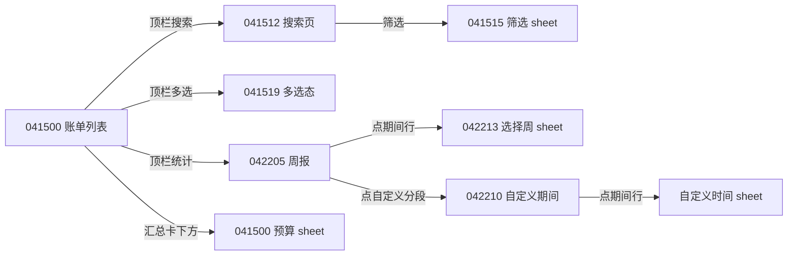

# 参考截图拆解 · B 组（账单 4 张 + 报表 3 张）

对象：`Screenshot_20261028_041500 / 041512 / 041515 / 041519 / 042205 / 042210 / 042213`（一木记账，浅色模式，系统默认中文字体）。
用途：为「今日小票」§3.2 账单页 / §3.3 统计页提供竞品参数参照。只学模式，不抄品牌。

## 0. 读取与换算

- **实际打开**：7 张全部读取成功；另对 9 个局部做了 1:1 裁剪放大复看（汇总卡、筛选 sheet、多选行、柱图、环形图、AI 卡、周选择 sheet、报表页头、底栏），并对关键区域做了像素取色与字符墨迹高度测量。
- **未读到**：无。深色模式、动画时长、长按菜单、tab 切换手势在 7 张里都**没有画面证据**，本文凡涉这些一律标「推断」。
- **换算**：原图 1260×2800，按 `px ÷ 3 ≈ dp`（视口约 420dp 宽）折算。若以 360dp 视口为基准，本表所有 dp ×0.86。
- **本文所有数值标「约」**：文字尺寸由墨迹高反推（误差 ±2sp），间距按像素边界取整到 2dp。
- 背景被 sheet 遮罩压暗的截图（041500 / 042210 / 042213），颜色按 `实测 ÷ 0.68`（黑 32% 遮罩）反算。

---

## 1. `041500` — 账单列表 + 「设置每月预算」sheet

**页面/状态**：账单列表（当天有 1 笔），底部弹出预算 sheet，背景被 32% 黑遮罩压暗。
**状态关系**：从汇总卡底部的「设置预算」进入；关闭后回列表同一滚动位。

| 区块 | 内容 | 约高度 dp | 关键尺寸 / 圆角 / 间距 | 颜色 | 字号 / 字重 |
|---|---|---|---|---|---|
| 状态栏 | 04:22 + 图标 | 24 | — | 系统 | — |
| 顶栏 | ‹ 返回、标题「记账」、右侧 3 图标（日历 / 搜索 / 多选） | 56 | 左 24dp，图标 24dp，图标间距 约 28dp，右 16dp | 文字 `#1A1A1A`，图标同色 | 标题 约 22sp/600 |
| 提示条 | 喇叭图标 +「记账内测结束，相关功能暂不支持，详情 >>」 | 34 | 左右 12dp 外边距、圆角 8、内部左右 8dp | 底 `#F4E3C3`，字 `#E66F30` | 15sp/400，尾部「详情 >>」13sp |
| 汇总卡 | 「今日支出(元)」+ 睁眼图标 → `18.28` | 约 152（含预算条） | 宽 372（页边 24）、圆角 12、内边距 左 18 / 上 16；副题与数字间 6dp | 底 `#F5E2B3`，右上两枚白色 8% 装饰圆（r≈120dp） | 标签 15sp/400 `#6B6B63`；主值 约 26sp/700 tnum |
| └ 两列 | 本月支出(元) `631.92` ｜ 本月收入(元) `120.00` | 52 | 上方 0.5dp 分隔线（左缩进 18dp），两列等分 | 同上 | 标签 15sp/400；值 约 20sp/700 |
| └ 预算条 | 「设置预算，合理规划支出」+ › | 40 | 与卡片同宽同圆角下沿，上接 0.5dp 发丝线 | 底 `#F4EFE5` | 15sp/400 `#6B6B63` |
| 分组卡 | 卡头「10月28日 今日」 ｜ 右「支18.28　收0.00」 | 55 | 白卡圆角 12；卡头下 0.5dp 线**不缩进**（全卡宽） | 卡 `#FFFFFF`，线 `#EEEEF0` | 左 17sp/600；右 15sp/400 `#8E8E93`（单字前缀「支/收」） |
| 账单行 | 餐饮 图标 +「餐饮」+ 来源 chip +「18:12 ｜ 美团平台商户」+ 右「-18.28」 | 76 | 行左右 16dp；图标 40dp（**彩色字形、无底块**）；chip 距标题 8dp | chip 1dp 描边 `#D9D9DE`、文字 `#8E8E93`；小字 `#8E8E93` | 标题 17sp/600；chip 11sp；小字 15sp；金额 17sp/600（**带负号**） |
| sheet | 标题「设置每月预算」、×、`¥` 输入、下划线 | 顶部起 445 | 顶圆角 20，内容左右 32 | 底 `#F5F5F6` | 标题 20sp/600；¥ 26sp/600；数字 约 34sp/700 |
| └ 输入 | 空值 + 2dp 光标；下划线；「本月已支出 ¥ 631.92」 | 96 | 下划线 1dp、左右 32、距上 24；辅助行距线 16 | 线 `#D9D9DE`，光标 `#415FFF` | 辅助 15sp `#8E8E93` |
| └ 键盘面板 | 1–9 / ⌫ / － / ＋ / 0 . 确定 | 214 | **白底面板 + 顶部 1dp 发丝线**；4 列，键高 约 53，键宽 约 100；「确定」87×47 圆角 8 | 面板 `#FFFFFF`；确定 `#415FFF` | 数字 22sp/500；确定 17sp/600 白字 |

**视觉重点**：金色卡上的 `18.28`——整页唯一 >20sp 的字，也是唯一色块；其余全灰白。
**对齐**：所有行「左文右数」，文字起点统一（图标 40 + 12 间距 = 52dp）；金额右端对齐卡内 16dp；卡片页边 24dp；卡头分隔线不缩进，行分隔线缩进 52dp。
**交互（推断）**：睁眼图标 = 隐藏金额；顶栏日历图标切月份视图，搜索 → `041512`，多选 → `041519`；行点击进详情/编辑；来源 chip 不可点（纯标注）；预算保存后应出现「已用 631.92 / 上限」进度（本组未出现进度画面）。

---

## 2. `041512` — 搜索页（空查询、IME 已拉起）

**页面/状态**：搜索页初始态，输入框聚焦，无任何历史与空态提示。
**状态关系**：从 `041500` 顶栏搜索图标进入；返回回列表。

| 区块 | 内容 | 约高度 dp | 关键尺寸 / 圆角 / 间距 | 颜色 | 字号 / 字重 |
|---|---|---|---|---|---|
| 顶栏 | ‹ ＋ 搜索胶囊 ＋「搜索」＋「筛选」 | 56 | 返回 24dp（左 24）；胶囊 x 60→335（宽 275、高 37、全圆、内左 14）；「搜索」与胶囊间距 24；「筛选」再右 24、右页边 14 | 胶囊 `#E6E6E8`；占位 `#9A9A9E`；「搜索」`#415FFF`；「筛选」`#1A1A1A` | 占位 15sp；「搜索」16sp/600；「筛选」17sp/500；放大镜 16dp |
| 结果区 | **空**：无「最近搜索」、无热门、无空态文案、无分隔线 | 余下全部 | — | 底 `#F2F2F4` | — |

**视觉重点**：没有（这正是缺陷页，视觉焦点落在唯一的蓝字「搜索」上）。
**对齐**：单行水平串联，全部垂直居中于 56dp 顶栏。
**交互（推断）**：输入即搜（无防抖证据）；「搜索」= 立即执行；「筛选」→ `041515`；返回键先收键盘再退页。

---

## 3. `041515` — 筛选 sheet（覆盖在搜索页上）

**页面/状态**：底部筛选浮层，背景仍是搜索页（可见同一搜索胶囊），遮罩 32% 黑。
**状态关系**：搜索页「筛选」→ 本层；确认/重置后回搜索页。

| 区块 | 内容 | 约高度 dp | 关键尺寸 / 圆角 / 间距 | 颜色 | 字号 / 字重 |
|---|---|---|---|---|---|
| sheet | 顶部起 约 246、顶圆角 20、内容左右 约 30 | — | 底部安全区预留 | `#F5F5F5` | — |
| 标题行 | 「筛选」居中 ＋ × 右 | 56 | × 24dp，右 24 | `#1A1A1A` | 20sp/600 |
| 分组：收支类型 | 支出 / 收入 | 42 | 组标题 上距 24、下距 12 | 未选底 `#E9E9E9` 无描边 | 组标题 15sp/400 `#8E8E93`；chip 14sp |
| chips | 高 42、全圆、水平内边距 约 18、行内间距 17 | 42 | — | 选中推断 `#E4E7FA` + 蓝字（本图未选中态） | — |
| 分组：时间 | 今年 / 去年 / 本月 / 上月（4 个等分填满一行，各 76） | 42 | 行内间距 18 | 同上 | 同上 |
| 日期行 | 「输入起始日期」—「输入截止日期」 | 42 | 两胶囊各 76、中间 20dp 横线 1dp | 占位 `#A0A0A5`，横线 `#C7C7CC` | 15sp |
| 分组：分类 | 左 label「分类」｜右「去选择分类 ›」 | 40 | 右侧入口靠右页边 | 入口 `#1A1A1A` | 15sp/500 |
| 分组：金额 | 「输入最低金额」「输入最高金额」 | 42 | 同日期行 | 同上 | 15sp |
| 分组：账单来源 | 支付宝 / 短信 / 二维码 / 微信自动记账 + 手动记账（**换行、被底栏裁切 → sheet 可滚动**） | 2 行 约 96 | 行间距 12、列间距 17 | 同上 | 14sp/400 |
| 底栏 | 「重置」左半居中、「确认」右半居中 | 56 | 顶部 1dp 发丝线；两个命中区各占 50% 宽 | 线 `#EDEDF0`；两个按钮均 accent | 重置 17sp/500，确认 17sp/600 |

**视觉重点**：无强调色块，视线由「确认」蓝字收尾。
**对齐**：所有分组标题与 chips 左边缘同一 x；底栏 25% / 75% 居中，不是左右贴边。
**交互（推断）**：chips 点击切换（是否单选未定）；分类 → 二级九宫格 sheet；日期胶囊 → 系统日期选择器；确认后 sheet 收起并回列表，条件以行内 chip 呈现（本组无该画面）。

---

## 4. `041519` — 列表多选态

**页面/状态**：账单列表进入多选，已选 0 项；删除按钮为禁用外观。
**状态关系**：`041500` 顶栏多选图标 → 本态；「取消」/返回退出回 `041500`。

| 区块 | 内容 | 约高度 dp | 关键尺寸 / 圆角 / 间距 | 颜色 | 字号 / 字重 |
|---|---|---|---|---|---|
| 顶栏（替换） | 「全选」｜居中「已选择0项」｜「取消」 | 56 | 左右 24 | 两个字按钮 `#415FFF`，中间 `#1A1A1A` | 17sp/500；中 17sp/600 |
| 列表 | 卡片保留，**未选中行约 45% 不透明**做降噪；分组头仍在 | — | 与 `041500` 同构 | 卡 `#FFFFFF`、页 `#F2F2F4` | 同上 |
| 行首复选框 | 圆角方框 | 20 | 20dp、圆角 4、描边 1.5dp；行文字整体右移 44dp | 描边 `#C7C7CC`；选中推断 accent 实心 + 白勾 | — |
| 悬浮删除 | 「删除」胶囊浮在列表之上 | 43（高） | 宽 约 313、居中、距底 约 45、全圆 | 底 `#C7CFFF`（accent 30%）+ 白字 = **禁用态** | 24sp/700 白 |
| 行内小字 | 「15:24 ｜ 振华网络服务」 | — | 两段之间 1dp 竖线 | `#8E8E93` | 15sp |

**视觉重点**：淡蓝删除胶囊（唯一色块，且明显「按不下去」）。
**对齐**：顶栏三段分别在左/中/右；复选框与图标块同列；金额仍右对齐。
**交互（推断）**：点行勾选/取消；全选 ↔ 取消全选（文案会变）；≥1 选中时胶囊变 accent 实心、可点，删除后无撤销（本组无 toast 证据）；多选态左滑删除禁用；返回键先退出多选。

---

## 5. `042205` — 报表页（周报 · 支出）

**页面/状态**：统计页默认态，周报 + 支出。
**状态关系**：`041500` 顶栏统计图标进入；是 `042210`/`042213` 的父页。

| 区块 | 内容 | 约高度 dp | 关键尺寸 / 圆角 / 间距 | 颜色 | 字号 / 字重 |
|---|---|---|---|---|---|
| 顶栏 | ‹ ＋「收支报表」＋ 右「订阅设置」 | 56 | 返回 24（左 24）；标题左 64 | 标题 `#1A1A1A`；右 `#415FFF` | 22sp/600；右 17sp/600 |
| 分段 | 周报 / 月报 / 年报 / 自定义 | 56 | **4 等分全宽**（各 105）；下划线宽=文字（约 44）、厚 2、圆角 1、距文字 6 | 选中 `#1A1A1A`；未选 `#B4B4B8`；线 `#415FFF`；下方 1dp 全宽发丝线 | 18sp（选中 600 / 未选 400） |
| 期间行 | 左 `‹` 圆键 +「10/26-11/1(本周)」+ `›`；右 支出/收入 chips | 56 | ‹› 20dp 圆、内 chevron 12dp；chips 高 30、水平内边距 16、间距 12 | 圆键 `#F2F2F3`；支出选中底 `#E4E7FA`+蓝字；收入底 `#EFEFF1`+墨字 | 期间 18sp/500；chip 18sp |
| 图表卡 | 标题「周支出对比」→ 5 根柱 → 双行标签 | 约 300 | 柱宽 20、圆角 4（只上圆）、pitch 70（均分卡宽）、柱区 140；值距柱顶 6；标签两行 | 当前柱 `#415FFF`，其余 `#B5C5FF`；值 当前 `#415FFF` / 其余 `#9A9AA0`；基线 1dp 浅灰 | 标题 17sp/600；柱值 13sp/500；标签 13sp（当前 600） |
| 排行卡 | 标题「10/26-11/1(本周)支出排行」 | 48 | 标题内联期间 | `#1A1A1A` | 17sp/600 |
| └ 排行行 | 图标 +「咖啡奶茶」+ 来源 chip +「-7.90」；第二行「2026/10/26 11:49」左 ｜「luckincoffee」右 | 76 | 图标 36；分隔线左缩进 52（相对卡片）；chip 同账单行 | 小字 `#8E8E93` | 名称 17sp/600；小字 15sp；金额 17sp/600 |
| 底栏 | 记账 / 报表 /〔＋ 记一笔〕/ 发现 / 设置 | 82（含手势区） | **整条平铺**（非浮动胶囊）：图标 20 + 标签 13，间距 6；中间圆键 48dp + 3dp 白色外环，上浮 8 | 底 `#F7F7F8`（约 96% 不透明）+ 顶部 1dp 线；选中 `#415FFF`，未选 `#9A9A9E`；圆键 `#415FFF` | 标签 13sp |

**视觉重点**：实心蓝的「当前周」柱 + 底部蓝色＋。
**对齐**：页边 24；柱与下方标签同轴居中；排行金额右端 24；分段 4 等分中心对齐。
**交互（推断）**：分段下划线随之滑动；‹› 切上一/下一周；点日期文字 → `042213` 选择周；支出/收入切换整页重算；点柱出气泡（金额 + 笔数）再点进该期明细；排行行点进明细；「订阅设置」是竞品自带订阅功能（与本项目无关）。

---

## 6. `042210` — 自定义期间 + 分类构成 +「自定义时间」sheet

**页面/状态**：统计页切到「自定义」，背景被遮罩压暗，底部弹出时间范围 sheet。
**状态关系**：`042205` 点「自定义」分段 → 本页；点期间文字/箭头 → 本 sheet。

| 区块 | 内容 | 约高度 dp | 关键尺寸 / 圆角 / 间距 | 颜色 | 字号 / 字重 |
|---|---|---|---|---|---|
| 分段 | 自定义 选中 | 56 | 同 §5 | — | — |
| 期间行 | 「2026/9/29-2026/10/28 ⌄」+ 支出/收入 chips | 56 | **箭头换成下拉 chevron 12dp**（非 ‹›） | 同上 | 18sp/500 |
| KPI 卡 | 支出(元) `670.32` ｜ 收支结余(元) `-550.32` | 88 | 2 列，内边距 20；两列数值都右对齐 | 卡底 `#F5F5F5`（与页面 `#F2F2F4` 几乎同色，**层次很弱**）；负数仍墨黑 | 标签 15sp/400 `#8E8E93`；值 26sp/700 |
| 分类构成卡 | 标题 + 右上 主分类/子分类 chips + 环形图 | 约 340 | 环外径 174、内径 约 50%（87）、段间 1dp 白缝；引线 1dp 段色 + 横向 24dp；中心值 20sp/600 | 段色 约 蓝 `#3F5BE8` / 天蓝 `#80BBF4` / 青 `#35B0B2` / 黄 `#D9C40E`（品牌色，**不用抄**）；标签 `#5A5A5A`（不着色） | 标题 17sp/600；标签「名称 百分比」15sp；中心 20sp/600 |
| sheet「自定义时间」 | 标题 + 快捷选择 4 chips + 自定义两胶囊 + 确定 | 顶部起 约 500 | 顶圆角 20；chip 高 39、全圆、内边距 20、间距 14；两胶囊各 约 150 宽、中间 20dp 短横线 | chips `#EFEFF1`；确定 **2dp 蓝描边 + 白底 + 蓝字**（描边胶囊） | 组标签 17sp/600；chip 20sp；确定 20sp/600 |
| └ 确定按钮 | 全宽（左右 24）胶囊 | 约 52 | 底部距安全区 12 | 边框 `#415FFF` | — |

**视觉重点**：环形图 + 中心数字（`338.76` = 消费段金额，即**中心值显示当前/最大段金额**，670.32 × 50.5% ≈ 338.5 已核对）。
**对齐**：环图居中于卡，左右标签对称挂在环外；KPI 两列分别左/右对齐到卡内边距；页边 24。
**交互（推断）**：快捷 chips 点即回填两个日期胶囊；点胶囊弹系统日期选择器；确定后关闭并重算；点环某段 → 中心值与跳转目标切换；主分类/子分类 chips 重算构成。

---

## 7. `042213` — 周报 + AI 小结 + KPI 四格 +「选择周」sheet

**页面/状态**：周报页（滚到 AI 卡 + KPI 区），点期间行打开「选择周」浮层。
**状态关系**：`042205` 期间行点击 → 本 sheet；选周后回周报并重算。

| 区块 | 内容 | 约高度 dp | 关键尺寸 / 圆角 / 间距 | 颜色 | 字号 / 字重 |
|---|---|---|---|---|---|
| AI 小结卡 | 头像 + 「AI 周度小结」+ 2 行正文 + 内联链接「查看 AI 账单分析 ›」 | 100 | 圆角 14；**头像 45dp 骑在卡片左上角外**（左 32、上溢出 12），正文左缩进 约 96 避让 | 底 淡紫渐变 约 `#DDE3F5 → #C7D0F0`（遮罩反算） | 标题 17sp/600；正文 15sp，**行高 约 27（1.6）**；链接 15sp/600 accent |
| KPI 2×2 | 本期支出 `232.32` / 日均 `77.44` / 比上周 `116.66` / 结余 `-232.32` | 约 176 | 2×2，格间 1dp 发丝线十字；内边距 20；**无 ▲▼ 箭头** | 卡底近页面色（层次弱）；负数墨黑不着色 | 标签 15sp/400；值 26sp/700 |
| sheet「选择周」 | 标题 + 月份 ‹ 2026年10月 › + 周网格 | 顶部起 约 500 | **顶部圆角 32–36**（比其他 sheet 大）；月份圆键 21dp | 标题/月份 `#1A1A1A`；圆键 `#F0F0F2` | 标题 20sp/600；月份 20sp/600 |
| └ 周格 | 「第 41 周」+「10/5—10/11」，3 列 | 单行 约 98 | 格内居中；当前周 = 全圆胶囊 | 选中底 `#E3E6F7` + 两行均 accent | 20sp/600 + 15sp |
| └ 底部 | **无确认按钮** | — | — | — | — |

**视觉重点**：AI 卡（唯一大色块，渐变 + 骑角头像制造「智能体」感），其次 26sp 的 KPI 数字。
**对齐**：AI 卡文字左对齐但整体右移避让头像；KPI 两列各自左右贴内边距；周格全部居中。
**交互（推断）**：点任一格立即生效并关闭（无确认按钮）；‹› 按自然月翻；× 或遮罩关闭不改变原选择。

---

## 2. 本组状态链

---

## 3. 本组共性设计系统

**间距栅格（4 的倍数，基准 24）**

| 用途 | 值 |
|---|---|
| 页面左右边距 | 24（卡片 x=24→396，宽 372） |
| 卡片内边距 | 16–20（汇总卡 18/16，KPI 20） |
| 卡内行左右 | 16（图标起点 52） |
| 卡与卡之间 | 12 |
| sheet 内容左右 | 约 30（比页面宽 6，说明 sheet 自带更大内边距） |
| 分组之间（sheet 内） | 24–28 |
| chip 行间距 | 12–18（参考不统一） |

**圆角档位（参考其实有 5 档，不干净）**

| 档 | 值 | 用在哪 |
|---|---|---|
| XS | 4 | 来源 chip、柱顶 |
| S | 8 | 提示条、键盘「确定」 |
| M | 12–14 | 卡片、AI 卡 |
| L | 20 | 大多数 sheet 顶角 |
| XL | 32–36 | 「选择周」sheet（**同一 App 内不一致，是缺陷**） |
| 全圆 | — | 所有 chip、期间胶囊、日期胶囊、删除胶囊、导航圆键 |

**字号档位（反算）**：22（页标题）· 20（sheet 标题、期间值、周格、chips 大号）· 18（分段、报表 chips）· 17（列表标题、分组头、排行）· 15（正文、小字、标签）· 13（图注、柱值、底栏标签、chip 内 11–14）。
字重只有 400/500/600/700 四档；**金额与 KPI 用 700，列表标题 600，正文 400**。

**色板**

| 用途 | hex |
|---|---|
| 页面底 | `#F2F2F4` |
| 卡片 | `#FFFFFF` |
| sheet 底 / 键盘面板 | `#F5F5F6` / `#FFFFFF` |
| 主文字 / 次 / 三级 / 占位 | `#1A1A1A` / `#8E8E93` / `#B4B4B8` / `#A0A0A5` |
| 发丝线 | `#EEEEF0`（卡内）、`#EDEDF0`（区块间） |
| chip 未选 | `#E9E9E9`（sheet 内）/ `#EFEFF1`（页面内） |
| chip 描边 | `#D9D9DE` |
| accent（主蓝） | `#415FFF` |
| accent 淡底（选中 chip） | `#E4E7FA`（实测 `#E3E6F7`） |
| accent 30%（禁用胶囊） | `#C7CFFF` |
| 强调卡（金） | `#F5E2B3`，副条 `#F4EFE5` |
| 警示条 | 底 `#F4E3C3`，字 `#E66F30` |
| AI 卡渐变 | `#DDE3F5 → #C7D0F0` |
| 柱图 | 当前 `#415FFF`，其余 `#B5C5FF` |

**图标风格**：顶栏 24dp 线性（1.8dp 描边、圆角端点）；列表分类图标 36–40dp **彩色实心**（自有品牌色 + emoji 式字形，部分带青色对勾角标表示「自动记账」）；底栏 20dp 实心/面性图标。**图标与文字永不并排重复**。

**空状态 / 图表画法**
- 空状态：本组只有搜索页一个「空」，而它是**全空无提示**（缺陷）。列表/图表空态在 7 张中均未出现，不可学。
- 柱图：无 Y 轴、无网格线、只留 1dp 基线；值在柱顶（当前期变 accent）；两行期标签；柱顶圆角、底部齐平基线。
- 环图：内径约 50%，段间 1dp 白缝，标签单行「名称 百分比」用灰色文字 + 同色引线；中心值为「当前段金额」。
- 所有图表都不放图例，不做 tooltip 动画证据。

**排序/层级原则**：一屏只有一个色块（金卡或 AI 卡或选中的蓝色），其余靠字重与灰阶分层；数字一律比同级文字大 9–11sp。

---

## 4. 对照 `docs/APP-DESIGN.md` §3.2 / §3.3

### 4.1 已经学到的（保持，不用改）

| # | 条目 | 证据 |
|---|---|---|
| 1 | 账单页三段式：汇总条 → 搜索/筛选行 → 日期分组卡 | 041500 / 041512 / 041519 |
| 2 | 分组卡头「左日期，右 `支x　收y` 单字前缀」 | 041500 / 041519 |
| 3 | 行内三元素 + 0/1 行可选小字；行分隔线左缩进避开图标 | 041500 / 042205（缩进 52dp ≈ 我们 58dp） |
| 4 | 筛选 sheet = 分组 label + 换行 chip + 固定底栏「重置/确认」 | 041515 |
| 5 | 多选 = 顶栏三件套 + 行首复选框 + 底部悬浮删除胶囊 | 041519 |
| 6 | 统计 = 4 等分分段（2dp 下划线宽=文字）+ 期间切换 + 支出/收入 chip | 042205 / 042210 |
| 7 | 柱图：无 Y 轴、值在柱顶、两行期标签、当前期高亮 + 其余 30% alpha | 042205（与我们 30% 完全一致） |
| 8 | 环图 + 引线 + 名次列表；主/子分类切换 | 042210 |
| 9 | 排行行结构 + 「查看全部」式的长列表范式 | 042205 |
| 10 | 中间圆键「白/挖空外环 + 上浮」 | 042205 底栏（48dp 圆 + 3dp 白环） |
| 11 | 页边 24 / 卡内 16–20 / 卡间 12 的栅格 | 全 7 张一致 |

### 4.2 遗漏的（参考有、文档没写，建议补）

| # | 遗漏点 | 参考参数 | 补进哪 |
|---|---|---|---|
| 1 | **来源 chip 的位置在标题右侧**，不是第二行 | 高 20dp、圆角 4、1dp `#D9D9DE`、11sp、距标题 8dp | §3.2 行解剖 |
| 2 | **搜索页框内/外的「搜索」文字按钮** | 胶囊右侧 24dp 处，16sp/600 accent | §3.2 搜索页 |
| 3 | **多发丝线规则**：卡头线不缩进、行线缩进、区块间线 | 0.5 / 0.5 / 1dp | §3.2、§3.3 |
| 4 | **禁用态表达**（删除按钮 0 选中） | accent 30% `#C7CFFF` + 白字 | §3.2 多选 |
| 5 | **sheet 数字键盘面板规范** | 白面板、顶 1dp 线、键高 53、数字 22sp、确定 87×47 圆角 8 | §4.1 手动表单 |
| 6 | **「选择周」浮层**：3 列周网格、点即生效、无确认按钮、月份 ‹ › | 格 约 104×98、选中 pill、标题 20sp/600 | §3.3 期间切换 |
| 7 | **四格 KPI 是 2×2 单卡 + 发丝十字**，且首格是「本期支出」 | 值 26sp/700 | §3.3（我们写「四格」但没定值字号与内边距） |
| 8 | **AI 卡头像骑在卡角外**（左 32、上溢 12） | 45dp 圆 + 渐变环 | §3.3 AI 小结卡 |
| 9 | **AI 卡正文行高 1.6、15sp**，链接内联在末行 | 行高 约 27dp | §3.3 |
| 10 | **顶部警示/说明条**组件（图标 + 一行字 + 尾部链接） | 高 34、圆角 8、底 `#F4E3C3`、字 15sp | 新增 `Banner`（可用于「通知记账未开」「演示数据」） |
| 11 | **金额统一带正负号**（支出前缀 `-`） | 041500 `-18.28`、042205 `-7.90` | §3.2 表格「金额」栏 |
| 12 | **底栏标签 13sp + 图标 20dp**、选中色只有 accent | 042205 | §2 导航胶囊 |

### 4.3 学错的 / 不该照抄（含我们文档与参考冲突处）

| # | 参考做法 | 冲突点 | 我们的处理 |
|---|---|---|---|
| 1 | 汇总卡是整块金色 `#F5E2B3` + 装饰圆斑 | 违反「accent 不填充、无渐变无装饰」 | **不抄**：白卡 + 26sp 大数字做焦点 |
| 2 | 分类图标用彩色 emoji 字形/彩色圆底 | 违反「emoji 只在小票与徽章」 | **不抄**：40dp `Fill` 底 + `Ink` 线图标 |
| 3 | 行标题用「分类名」，副行「时间 ｜ 商户」 | tt#11 明确否掉 | **不抄**：商户名当标题，副行只放备注/来源 |
| 4 | 「自定义时间」sheet 的确定按钮是 2dp 描边胶囊 | 违反「无描边、按钮只两级」 | 改**实心墨黑胶囊 52dp** |
| 5 | 报表顶栏右侧塞蓝色文字按钮「订阅设置」 | 顶栏只留图标 | 顶栏只用 `ReceiptLong` 一个图标 |
| 6 | 分段未选中用 `#B4B4B8` | 与白底对比约 2.4:1，不达 4.5:1 | 用 `InkTertiary #8E8E93`（约 3.3:1，仍偏浅，配 600 字重补偿） |
| 7 | KPI 卡底 `#F5F5F5` 贴着页底 `#F2F2F4` | 卡片层次几乎消失 | 白卡 `#FFFFFF` |
| 8 | 负结余 `-232.32` 与正数同色同字重 | 我们要求正负号用语义色 | 负号 + 数字用 `Negative #D70015`，不加底色 |
| 9 | 同 App 内 chip 高 30 / 39 / 42 三种、sheet 顶角 20 / 36 两种 | 不统一 | 统一：chip 36、sheet 顶角 28 |
| 10 | 搜索页空态完全无内容 | 违反「每个信息块要有非文字锚点 + 空态」 | 补空态（见 4.4） |
| 11 | 多选态用「行透明度 45%」表达未选中 | 与「层次靠底色 + 留白 + 字重」不符，且影响可读性 | 改用复选框 + 选中行 `AccentSoft` 淡底，不做整行降透明 |
| 12 | AI 卡渐变 + 头像渐变环 | 违反「无渐变」 | 白卡或 `#F5F5F7` 弱底 + accent 8% 圆角块；头像用纯色 `Fill` + AI 字形 |

### 4.4 「今日小票」具体改法（页面 + 参数）

**A. 账单页（§3.2）**

1. `TxnRow` 布局改为 `Row(图标40 | Column(标题17/500 + chip) , Spacer, 金额17/600)`；来源 chip **移到标题右侧**：高 20dp、圆角 4dp、1dp `#D9D9DE` 描边、11sp `InkSecondary`、左间距 8dp；第二行只保留用户备注（13sp）。
2. 行高：单行 `minHeight 56dp`、有第二行 `76dp`（替换现在的「64 / 72」固定值）；分隔线左缩进保持 58dp。
3. 汇总条：主值 22 → **26sp/600 tnum**，卡高 88 → **96dp**；卡内分隔线改 **0.5dp**（`Hairline`），加一条 13sp 次级入口「本月已打印 N 张 ›」（占参考「设置预算」的位置，不给理财建议）。
4. 金额显示：支出统一 **带 `-` 前缀**（`Cents.yuan()` 前缀逻辑放 `TxnRow`），收入 `+` 且 `Positive`。
5. 顶栏：`Banner` 组件（新增）高 **34dp**、圆角 **8dp**、底 `#FFF4E5`、字 `Warning #B25000` 13sp、左图标 16dp、右侧 13sp 链接；用于「通知记账未开」与常驻「演示数据」提示。
6. 搜索行：胶囊高 **40dp**、底 `Fill #EDEDF0`、左放大镜 18dp、占位 15sp `InkTertiary`；胶囊右侧 12dp 放「搜索」16sp/600 accent，再右 16dp 放「筛选」16sp/500（有条件时「筛选 2」）。
7. 搜索页空态：首行「没有匹配的账单」13sp `InkSecondary` + 「清空条件」accent 链接；下方「最近搜索」13sp 标题 + 最多 6 个 36dp chip；无历史时整块只留一行空态，不留白屏。
8. 多选：顶栏三段（全选 17sp/500 accent / 已选 N 项 17sp/600 / 取消 17sp/500 accent）；复选框 **20dp、圆角 4dp、1.5dp `#C7C7CC`**，选中 = accent 实心 + 白勾；删除胶囊 **宽 300dp、高 48dp、全圆、距底 96dp 悬浮**；0 选中 `#C7CFFF` + 白字（禁用），≥1 选中 `Negative #D70015` 实心白字。
9. 筛选 sheet 底栏：改为**左右各 50% 居中**（重置 25% 处、确认 75% 处），17sp/600；sheet 顶角统一 **28dp**，内容左右 **24dp**，chip 统一 **36dp**、未选 `Fill`、选中 `AccentSoft + accent 600`、组间 24dp。

**B. 统计页（§3.3）**

10. 分段：未选色改 `InkTertiary`；下划线 **2dp、宽=文字宽、圆角 1dp、距文字 6dp**；分 4 等分全宽、文字居中。
11. 期间行：高 **56dp**；‹ › 圆键 **20dp**（底色 `Fill`，chevron 12dp）；日期 17sp/500；右 chips **36dp**（与筛选统一，不用参考的 30dp）。
12. 新增「选择周」sheet：顶角 28、标题 20sp/600 居中 + × 24dp；月份行 20sp/600 + 20dp 圆键；**3 列周网格**，格 104×72dp，两行（「第 43 周」17sp/600 /「10/26—11/1」13sp `InkSecondary`），当前周 = `AccentSoft` 全圆 + 两行 accent；**点击即生效**；不动画、不弹确认。
13. 柱图：柱宽 **20dp**、圆角 **4dp 只上圆**、pitch = (卡宽 − 32) / 5、柱区高 140dp；柱顶值 **13sp/500**（当前期 accent，其余 `InkSecondary`）；底部两行标签 **13sp**（当前期 600）；基线 1dp `Hairline`，无网格线。
14. 环图：外径 **174dp**（或卡宽 − 96）、**内径 50%**、段间 1dp 背景色缝、引线 1dp 段色 + 横向 24dp；标签「名称 百分比」**15sp `InkSecondary`**（文字不着色，只有线着色）；中心显示**当前段金额** 20sp/600。
15. 排行行：图标 **36dp**；第二行放**两段**——左「N 笔」13sp、右商户名 13sp（替代现在的单段）；金额 17sp/600 右对齐；分隔线左缩进 52dp。
16. 四格 KPI：白卡 2×2、内边距 **20dp**、发丝十字、值 **26sp/600** tnum；环比格**保留 ▲▼**（参考没有，但 tt 要「一眼看懂」，箭头比裸数字更省认知），箭头与百分比用 `Positive/Negative`，其余墨黑。
17. AI 小结卡：高 **100dp**、圆角 14；头像 **45dp 骑左上角**（左 24dp、上溢出 12dp），卡内文字左缩进 **84dp**；标题 17sp/600；正文 **15sp、行高 1.6**、最多 2 行；链接**内联在末行**末尾（15sp/600 accent + ›）；底色 `#F5F5F7` 弱底（不用渐变）；算不出就整卡隐藏（沿用 §3.3 规则）。

**C. 全局 token（`XpRadius` / `XpColors` 增量）**

18. 新增 token：`HairlineInCard = 0.5dp`、`ChipSm = 20dp`（来源 chip）、`ChipHeight = 36dp`、`SheetTopRadius = 28dp`、`BannerBg/BannerFg`、`CapsuleFloat = 48dp`；把参考里 4 档 chip 高统一成 1 档。
